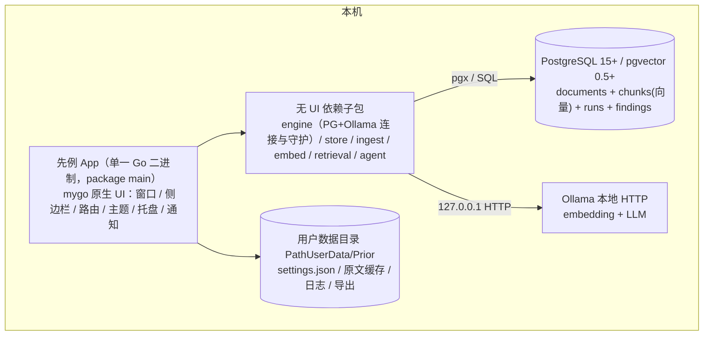
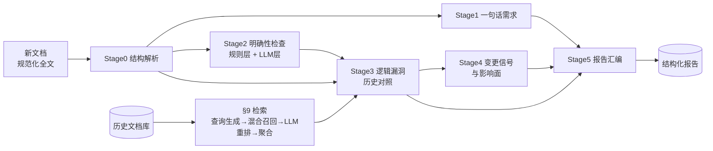

# 先例（Prior）· 产品需求文档（完整版）

| 项 | 值 |
|---|---|
| 产品名 | 先例（Prior） |
| 版本 | v1.1（定稿） |
| 日期 | 2026-10-15 |
| 状态 | 权威文档 |
| 定位 | 本地桌面 Agent：历史需求文档建库，新文档自动比对找逻辑漏洞 |
| 形态 | mygo **原生 UI** 桌面 App（纯 Go，无 webview / Electron / JavaScript） |
| 架构参考 | [missuo/motrix-mygo](https://github.com/missuo/motrix-mygo) |

> 本仓库 `prd/` 目录的唯一权威 PRD。轮次档案见 `prd/README.md`；本版相对 v1.0 的关键变化见 §27 版本历史与 §26 决策记录（Q3 形态翻转）。

> **v1.2 增补（2026-10）**：业务流程（文档直接入库 / 文档分析入库）、元数据与日期抽取规则、功能点变更账本、数据模型增量（`function_points` / `change_records` / `ingest_jobs`）以 [round-7.md](./round-7.md) 为准；本文未涉及处仍以本文为准。

## 1. 背景与问题

产品同学撰写或更新需求文档时，脑中携带大量未落笔的上下文：某个字段的历史口径、某条流程曾经的兜底分支、某次"全部改为 X"对存量数据的影响。这些隐性上下文不会写进新文档，开发按字面实现，于是产生纰漏：

- 新文档覆盖或推翻旧逻辑，但不说明对存量数据、存量接口、灰度回滚的影响；
- 新文档只写主流程，边界条件、异常分支、权限、并发口径缺失；
- "优化""尽快""批量"这类无量纲表述直接进开发，验收时各说各话；
- 历史文档散落在本地文件夹、网盘、Wiki，无人结构化维护，同样的坑反复踩。

同时，组织里沉淀的大量历史需求文档是宝贵资产，却从未被系统性利用。

## 2. 产品定位

- 产品名：**先例（Prior）**——新文档先对照历史先例，再进入开发。
- 一句话定义：一个**本地运行的个人桌面 Agent**，把历史需求文档建成可检索的知识库；新产品文档提交时，自动检索相关历史文档并交叉比对，输出四类结果——逻辑漏洞、不明确的细节、一句话需求清单、变更信号与影响面。
- 核心价值：把产品脑中的隐性历史上下文，变成显性的、带原文证据的问题清单；把"开发纰漏"从编码阶段前移到文档评审阶段拦截。
- 形态：单 Go 二进制的 mygo 原生 UI 应用，窗口由 mygo 在 GPU 上直接绘制。

## 3. 目标与非目标

**目标（v1 必须达成）**

- G1 批量导入历史需求文档，可靠去重，可搜索。
- G2 新文档自动完成：结构解析 → 检索相关历史文档 → 交叉分析 → 生成带证据的报告。
- G3 报告覆盖四类发现：逻辑漏洞、不明确项、一句话需求、变更信号。
- G4 全流程本地运行，文档数据不出本机（隐私红线）。

**非目标（v1 明确不做）**

- 扫描件 PDF 的 OCR（v1 标记为不可导入并提示原因，v2 评估）。
- 自动改写/修订文档正文，只给建议与问题。
- 团队协作、在线服务化部署、账号权限体系（v1 单机单用户）。
- 需求全生命周期管理（不追踪 Jira/排期/状态）。
- 代码生成、接口文档生成。
- 任何 web 前端 / webview 形态（不引入 React、Vite、Bun、TypeScript 工具链）。

## 4. 用户与核心场景

| 角色 | 核心诉求 |
|---|---|
| 主要：产品经理 | 发文前自查漏洞与不明确点，评审会上能被证据直面质疑 |
| 次要：开发负责人 | 拿到"变更影响面"和"边界口径"清单，减少返工 |
| 次要：测试 | 从"一句话需求"快速派生验收点 |

**C1 建库**：拖入约 50 篇历史 PRD（md/docx/pdf）→ 解析/切块/embedding/入库 → 逐篇状态与统计 → 重复文档提示处理。

**C2 分析**：拖入新文档 → 选范围（全库/指定产品线）→ 开始分析 → 阶段进度流实时可见 → 系统通知 → 直达报告。

**C3 消费与反馈**：报告顶部为「变更信号」（如"之前的逻辑全部不要了，全部改为 X"）与影响清单；其下「逻辑漏洞」（附历史文档证据对照）与「不明确项」（附建议向产品提的问题）；「一句话需求」可勾选出评审清单；逐条确认/误报 → 导出 Markdown 发评审群。

## 5. 总体架构



端到端流程：**建库**（导入 → 解析 → 规范化 → 结构感知切块 → Ollama embedding → pgvector 入库）→ **分析**（新文档结构解析 → 混合检索相关历史文档 → LLM 重排 → 五阶段分析 → 结构化报告）→ **消费**（筛选 / 证据对照 / 反馈 / 导出）。

**架构规则**（对齐参考项目 motrix-mygo）：

| 规则 | 内容 |
|---|---|
| view = state 纯函数 | `app` 结构体持有全部 UI 状态；`a.view(c *ui.Context)` 每帧从状态重绘。禁止把 `ui.Element` / `*ui.Context` 存进 `app` |
| 主线程纪律 | 引擎/分析 goroutine 一律经 `a.update(fn)`（内部 `win.Update`）修改状态；测试中 `win == nil` 时 `update` 同步执行，视图逻辑无窗口可测 |
| UI 与内核分离 | `engine/ store/ ingest/ embed/ retrieval/ agent/` 子包禁止 import `ui` |
| 错误即 toast | 内核调用返回 error，统一 `a.try(err)` 弹 toast 并刷新状态 |
| 单实例 | `mygo.App.RequestSingleInstanceLock()`；第二实例唤起已有窗口 |
| 托盘驻留 | 关闭窗口隐藏到托盘，分析继续；`OnBeforeQuit` 在分析/导入运行时弹确认框 |
| 数据目录 | `mygo.App.SetPath(mygo.PathUserData, …/Prior)`，应用自有目录，不与他应用混居 |

## 6. 目录结构

```
prd_viewer/
  prd/                      # 需求文档（本目录）
  mygo.json                 # name/identifier/version/out/updates(publicKey+GitHub)
  main.go                   # 生命周期：单实例锁 / 路径 / 菜单 / 托盘 / 窗口 / 退出确认 / updater 插件
  app.go                    # app 状态结构体 + view + router + update(fn) + try(err)
  library.go                # /library 文档库页（列表 / 筛选 / 导入 / inspector）
  import.go                 # 导入作业与进度
  analyze.go                # /analyze 分析台页（配置 / 进度 stepper / 日志 / 取消）
  report_list.go            # /reports 报告列表 + 打开报告（按 run 读 findings / 台账 / 预评审）
  report.go                 # 报告对话框（左侧菜单 / 文档视图 / 发现 / 证据对照 / 反馈 / 复制）
  report_document.go        # 文档视图：原文高亮与右侧结论面板
  history.go                # /history 历史分析页
  notifications.go          # 应用内通知页 + 系统通知
  settings.go               # settings.json 模型 / 环境自检 / 索引重建
  settings_view.go          # /settings 分区卡片 + 草稿保存
  theme.go                  # palette（light/dark/system + 强调色）
  widgets.go                # 共享控件：finding 卡片 / 严重度徽标 / 证据双栏 / 空态 / 进度行
  i18n.go                   # T()；en / zh-Hans 双语目录
  engine/                   # PG+Ollama 连接、健康检查、migration 运行（不 import ui）
  store/                    # pgx 数据访问 + migrations/*.sql
  ingest/                   # 解析 / 规范化 / 切块 / 去重
  embed/                    # Ollama embedding client
  retrieval/                # 查询生成 / 混合召回 / 重排 / 聚合
  agent/                    # 五阶段流水线 + prompts/
  resources/                # 图标
  scripts/                  # setup-mac.sh、docker-compose.yml、make-icon
  docs/                     # 使用说明 + screenshots/（live test 生成）
```

## 7. 功能需求

### 7.1 F1 文档库 `/library`

| 编号 | 功能 | 规则 |
|---|---|---|
| F1.1 | 导入 | 按钮（文件对话框 / 文件夹 / zip）+ 窗口拖拽；格式 md/docx/pdf/txt/html；队列串行 + 行内进度（解析→切块→embedding→入库） |
| F1.2 | 解析与切块 | 按 §11 管线；展示字数、分块数、解析质量标记 |
| F1.3 | 去重 | checksum 相同直接跳过；相似 >0.95 弹 `mygo.Dialog.Message` 选择：仍入库 / 作为新版本 / 取消 |
| F1.4 | 元数据 | 标题、产品线、业务域、版本、作者、状态（active/superseded/draft）；可编辑 |
| F1.5 | 浏览与搜索 | 虚拟列表 + 列（标题/格式/产品线/分块数/状态/导入时间），列宽与显隐可配；状态 filter chips + 关键词搜索（`Cmd+F`） |
| F1.6 | 详情面板 | inspector（`Cmd+I` 开关）：元数据 + 分块列表（heading_path 面包屑 + token 数，点击定位原文）+ 原文预览 |
| F1.7 | 删除 | 确认对话框；级联删除 chunks；既有 finding 保留，证据标记"源已删除" |

### 7.2 F2 检索

| 编号 | 功能 | 规则 |
|---|---|---|
| F2.1 | 查询生成 | 章节主题句 + 术语实体 + 全文摘要（≤500 字），上限 30 条 |
| F2.2 | 混合召回 | 向量 topK=50（cosine）+ 关键词（tsvector/trgm），RRF(k=60) 融合 → topM=200 chunk |
| F2.3 | LLM 重排 | 规则级相关性 0~1，≥0.5 进候选，按文档聚合 |
| F2.4 | 定位 | top 8 相关文档 + 相关章节（heading_path）；附章节×文档相关度矩阵 |

### 7.3 F3 分析 Agent

| 编号 | 功能 | 规则 |
|---|---|---|
| F3.1 | 一句话需求 | 规范化句 + 四元组（角色/动作/价值/约束）+ 原文映射；模型之外由规则层兜底 S0 漏抽的短句 |
| F3.2 | 明确性检查 | 规则层（含指代/范围、模糊量词）+ LLM 层五类；每条必带 question |
| F3.3 | 逻辑漏洞 | C1 文档间冲突 / C2 覆盖缺口 / C3 文档内前后不一致；C1/C2 必带历史证据，C3 两处原文都必须能在本文档定位 |
| F3.4 | 变更信号 | 正则粗筛 + LLM 确认；五维影响清单 |
| F3.5 | 运行控制 | 阶段进度事件、取消（context）、分阶段重跑、失败降级 |

### 7.4 F4 报告 `/reports` 与 `/report/{runID}`

| 编号 | 功能 | 规则 |
|---|---|---|
| F4.1 | 报告列表 | 一次运行一行：状态、开始时间、耗时、发现数、待处理数、预评审结论；状态筛选 + 搜索 + 重新读取；空态说明如何开始第一次评审 |
| F4.2 | 报告对话框 | 点列表一行打开独立对话框；左侧菜单：预评审 / 文档 / 全部发现 / 各类型 / 变更账本 / 模块需求历史；关闭或切页即退出 |
| F4.3 | 文档视图 | 原文按分块连续展示，问题在文字上高亮；点高亮在右侧打开结论，文档不跳页；标题路径不重复显示正在阅读的小节 |
| F4.4 | 证据对照 | 新文档引文 ↔ 历史文档引文（文档名 + heading_path）；文内矛盾标为「同一文档的另一处」；没有证据的一侧不画空栏 |
| F4.5 | 反馈 | 确认 / 误报 / 待补充 / 搁置，写回 `findings.status`；卡片显示已决状态 |
| F4.6 | 复制与问题清单 | 复制整份报告 Markdown 到剪贴板；预评审的「给产品的 N 问」一键复制 |
| F4.7 | 空态 | 报告读取失败、没有文档、没有匹配发现、没有变更记录，各显示原因与下一步 |

### 7.5 F5 设置 `/settings`

分区卡片（`ui.Grid`）：**环境**（PG DSN 与自检、Ollama 地址与模型列表、缺失模型 `ollama pull` 命令、索引重建任务、数据目录）｜**分析**（模型、温度、num_ctx、超时、默认分析范围、完成通知开关）｜**外观**（主题 system/light/dark、语言、强调色）｜**数据**（目录迁移提示、清空全部数据需输入 DELETE）｜**关于**（版本、检查更新、开源地址）。
连接/模型等重启生效项用草稿-保存模式（底栏 Save/Discard + `Cmd+S`）；外观与通知开关即时生效。

### 7.6 F6 桌面外壳

| 编号 | 功能 | 规则 |
|---|---|---|
| F6.1 | 窗口 | 默认 1024×680，最小 960×620；隐藏标题栏自绘 chrome（右侧避让窗口控制按钮）；`StateKey` 记忆；`AutoHideMenuBar`；侧边栏可折叠（带动画） |
| F6.2 | 菜单与托盘 | macOS 应用菜单（About / Check for Updates… / 标准 Role 菜单）；托盘菜单"显示 / 退出"；关闭窗口驻留托盘 |
| F6.3 | 通知 | 分析完成/失败系统通知（点击直达报告）+ 应用内通知页（未读徽标） |
| F6.4 | 拖拽 | 窗口拖拽导入 / 发起分析 |
| F6.5 | 引导向导 | 首启四步（PG → Ollama → 模型 → 数据目录），每步给命令与"重新检测" |
| F6.6 | 语言 | en / zh-Hans 双语，全部可见文案过 `T()`；默认跟随系统 |
| F6.7 | 更新 | updater 插件原生更新窗口，每日检查，菜单项与关于页开关 |

## 8. 引擎规格

### 8.1 发现（finding）统一结构（契约，落库与渲染唯一依据）

```json
{
  "id": "F-20261015-0031",
  "run_id": 12,
  "type": "logic_gap | ambiguity | one_liner | change_signal",
  "subtype": "conflict | coverage_gap | internal_conflict | quantified_ambiguity | undefined_reference | state_gap | permission_conflict | data_caliber | placeholder | missing_branch | incomplete_enumeration | passive_actor | unstructured_requirement",
  "severity": "S0 | S1 | S2 | S3",
  "confidence": 0.0,
  "title": "≤40 字结论句",
  "detail": "问题解释",
  "new_doc_span": { "quote": "新文档原文片段", "heading_path": ["3.2 会员积分"], "offset": 1234 },
  "evidence": [
    { "doc_id": 7, "chunk_id": 88, "doc_title": "积分规则PRD v2.1", "heading_path": ["积分扣减"], "quote": "历史文档原文片段" }
  ],
  "question": "建议向产品提出的澄清问题（ambiguity/change_signal 必填）",
  "suggested_fix": "建议补充/改写示范（可选）",
  "impact": "影响面描述（change_signal 必填）",
  "status": "open | confirmed | dismissed | needs_doc | deferred",
  "reviewer_note": ""
}
```

硬约束：所有 finding 必须带 `new_doc_span`；`logic_gap` / `change_signal` 必须带非空 `evidence`；`confidence < 0.5` 降级为 S3 展示，不进导出问题清单默认集。

### 8.2 严重度

| 级别 | 含义 | 典型例子 |
|---|---|---|
| S0 阻塞 | 直接导致无法实现或必然返工 | "之前逻辑全部作废改用 X"但无存量数据迁移说明 |
| S1 严重 | 明显逻辑冲突或关键口径缺失 | 新旧文档同一字段口径不一致且无说明 |
| S2 一般 | 边界/细节不明确，需确认 | 未说明失败重试次数、超时时间 |
| S3 提示 | 表述优化、命名一致性 | 同义术语混用 |

### 8.3 五阶段分析流水线



| 阶段 | 输入 | 输出 | 规则 |
|---|---|---|---|
| S0 结构解析 | 新文档 IR | `doc_profile`：doc_type / sections / requirement_items / glossary / stats | 规则识别需求条目（列表 / 用户故事 / 表格 / 编号标题）；glossary 由 LLM 抽取并经"出现 ≥2 次且有定义语"校验 |
| S1 一句话需求 | requirement_items | 需求卡：规范化句 + 四元组 + 原文映射 + 缺失项 | "作为<角色>、我希望<动作>、以便<价值>；约束/验收：…"；不得改写原意；无法规范化的转 ambiguity（unstructured_requirement） |
| S2 明确性检查 | 章节 + glossary + 规则命中 | ambiguity findings | 规则层六类见 §8.4；LLM 层五类（语义歧义 / 隐含假设 / 边界条件 / 数据口径 / 兼容性）；LLM 条目必填 question |
| S3 逻辑漏洞 | 检索命中历史块 + doc_profile + S2 输出 | logic_gap findings | C1 文档间冲突（默认 S1）；C2 覆盖缺口（默认 S2，措辞"需确认是否仍然适用"）；C3 文档内不一致；每条必带历史 chunk 证据 |
| S4 变更信号 | 新文档全文 + 相关历史文档 | change_signal findings | 正则粗筛 + LLM 确认；五维影响清单见 §8.5；缺失维度转 question；默认 S0/S1 |
| S5 报告汇编 | 各阶段 findings + 检索上下文 | report | 概览 + 分组 findings + "给产品的 N 问" + 引用清单 + run 元数据；空结果也必须产出"未发现"报告 |

**运行控制**：分阶段进度事件（经 `a.update` 推进 UI）；单阶段失败降级且保留已产结果；可取消（status=cancelled）；可分阶段重跑；重复发起互不覆盖。

### 8.4 明确性规则层（确定性检查）

| 规则 | 模式 | subtype |
|---|---|---|
| 占位符扫描 | `TBD/TODO/待定/待补充/xxx` | placeholder |
| 空引用 | "详见《X》"，X 未随文提供且不在库中 | undefined_reference |
| 模糊量词 | 快速/友好/优化/大量/偶尔/尽快/实时（无量化上下文） | quantified_ambiguity |
| 分支缺失 | 描述流程但无异常/回滚/空态分支 | missing_branch |
| 枚举不全 | 用"…等"列举业务实体 | incomplete_enumeration |
| 被动无主句 | "会被清理/会被同步"，缺主体或触发条件 | passive_actor |

### 8.5 变更信号影响清单（五维度）

| 维度 | 检查点 |
|---|---|
| 存量数据 | 迁移 / 保留 / 清理策略是否说明 |
| 接口兼容 | 老调用方、协议版本、字段废弃周期 |
| 灰度与回滚 | 切换策略、回滚路径 |
| 下游通知 | 受影响团队/系统是否列出 |
| 受影响旧需求 | 库中哪些历史需求条目被推翻（定位到 chunk） |

检测模式：正则粗筛（`不再|废弃|下线|之前的逻辑.*不要|全部改为|统一替换|历史.*作废`）+ LLM 确认与归类。

## 9. 检索规格

1. **查询生成**：章节主题句 / 术语实体 / 全文摘要（≤500 字），上限 30 条。
2. **混合召回**：每条查询向量 topK=50（cosine）+ 关键词命中（tsvector/trgm），RRF(k=60) 融合 → topM=200 chunk。
3. **LLM 重排**：输出 0~1 的**规则级相关性**（历史块与新需求是否存在规则约束关系，而非话题相似）；≥0.5 进候选。
4. **文档聚合**：文档分 = max(chunk 分) + 0.1 × Σ(其余 chunk 分)；取 top 8 文档 + 相关章节。
5. **上下文预算**：每文档进入 S3 的内容 ≤ 4000 tokens，按相关度截断，优先保留含情态词（必须/不得/应当/默认/上限）的规则性语句。
6. 附产物：新文档章节 × 相关文档相关度矩阵（报告页迷你热力图）。

## 10. 数据模型（PostgreSQL DDL）

```sql
CREATE EXTENSION IF NOT EXISTS vector;      -- pgvector >= 0.5
CREATE EXTENSION IF NOT EXISTS pg_trgm;

CREATE TABLE documents (
  id           BIGSERIAL PRIMARY KEY,
  title        TEXT NOT NULL,
  source_uri   TEXT NOT NULL,                 -- 原始文件路径
  format       TEXT NOT NULL,                 -- md/docx/pdf/txt/html
  doc_type     TEXT NOT NULL DEFAULT 'unknown',
  product_line TEXT,
  author       TEXT,
  version      TEXT,
  status       TEXT NOT NULL DEFAULT 'active',        -- active/superseded/draft
  superseded_by BIGINT REFERENCES documents(id),
  checksum     TEXT NOT NULL,
  char_count   INTEGER NOT NULL DEFAULT 0,
  chunk_count  INTEGER NOT NULL DEFAULT 0,
  embed_model  TEXT,
  created_at   TIMESTAMPTZ NOT NULL DEFAULT now(),
  updated_at   TIMESTAMPTZ NOT NULL DEFAULT now(),
  UNIQUE (checksum)
);
CREATE INDEX idx_documents_status  ON documents(status);
CREATE INDEX idx_documents_product ON documents(product_line);
CREATE INDEX idx_documents_title   ON documents USING gin (title gin_trgm_ops);

CREATE TABLE chunks (
  id           BIGSERIAL PRIMARY KEY,
  doc_id       BIGINT NOT NULL REFERENCES documents(id) ON DELETE CASCADE,
  chunk_index  INTEGER NOT NULL,
  heading_path TEXT[] NOT NULL DEFAULT '{}',
  content      TEXT NOT NULL,
  token_count  INTEGER,
  tsv          TSVECTOR,
  embedding    vector(1024),                  -- 维度随 embed 模型，更换须重建索引
  UNIQUE (doc_id, chunk_index)
);
CREATE INDEX idx_chunks_doc       ON chunks(doc_id);
CREATE INDEX idx_chunks_embedding ON chunks USING hnsw (embedding vector_cosine_ops)
  WITH (m = 16, ef_construction = 64);
CREATE INDEX idx_chunks_tsv       ON chunks USING gin (tsv);

CREATE TABLE analysis_runs (
  id            BIGSERIAL PRIMARY KEY,
  new_doc_id    BIGINT REFERENCES documents(id) ON DELETE SET NULL,
  title         TEXT,
  scope         JSONB NOT NULL DEFAULT '{}',   -- {"product_lines": [], "use_all": true}
  models        JSONB NOT NULL DEFAULT '{}',   -- {"embed": "...", "llm": "...", "params": {...}}
  status        TEXT NOT NULL,                 -- queued/running/succeeded/failed/cancelled
  current_stage TEXT,
  stage_log     JSONB NOT NULL DEFAULT '[]',
  error         TEXT,
  started_at    TIMESTAMPTZ,
  finished_at   TIMESTAMPTZ,
  created_at    TIMESTAMPTZ NOT NULL DEFAULT now()
);
CREATE INDEX idx_runs_status ON analysis_runs(status);

CREATE TABLE findings (
  id            BIGSERIAL PRIMARY KEY,
  run_id        BIGINT NOT NULL REFERENCES analysis_runs(id) ON DELETE CASCADE,
  type          TEXT NOT NULL,                 -- logic_gap/ambiguity/one_liner/change_signal
  subtype       TEXT,
  severity      TEXT NOT NULL,                 -- S0..S3
  confidence    REAL NOT NULL,
  title         TEXT NOT NULL,
  detail        TEXT NOT NULL,
  new_doc_span  JSONB NOT NULL,
  evidence      JSONB NOT NULL DEFAULT '[]',
  question      TEXT,
  suggested_fix TEXT,
  impact        TEXT,
  status        TEXT NOT NULL DEFAULT 'open',  -- open/confirmed/dismissed/needs_doc/deferred
  reviewer_note TEXT,
  created_at    TIMESTAMPTZ NOT NULL DEFAULT now(),
  updated_at    TIMESTAMPTZ NOT NULL DEFAULT now()
);
CREATE INDEX idx_findings_run ON findings(run_id, type, severity);

CREATE TABLE eval_cases (   -- 黄金评测集
  id           BIGSERIAL PRIMARY KEY,
  name         TEXT NOT NULL,
  source_doc_id BIGINT REFERENCES documents(id) ON DELETE SET NULL,
  gold         JSONB NOT NULL,                 -- 人工标注的预期 findings
  created_at   TIMESTAMPTZ NOT NULL DEFAULT now()
);

CREATE TABLE eval_results (
  id          BIGSERIAL PRIMARY KEY,
  case_id     BIGINT NOT NULL REFERENCES eval_cases(id) ON DELETE CASCADE,
  prompt_ver  TEXT NOT NULL,
  precision_p REAL,
  recall_p    REAL,
  detail      JSONB,
  created_at  TIMESTAMPTZ NOT NULL DEFAULT now()
);
```

要点：`documents.checksum` 唯一约束 = 一级去重；`chunks.embedding` HNSW 索引；`tsv` 应用侧写入（中文分词在应用侧）；findings JSONB 契约 = §8.1。**应用设置不落库**（见 §12 settings.json），故无 `settings` 表。

## 11. 入库管线

md（AST）/docx（OOXML）/pdf（文本层）/txt/html（标签剥离）→ 统一 IR（`heading|paragraph|list_item|table`）→ 规范化（去页眉页脚/页码/控制字符、表格转"行：列 | 列"文本、全半角归一）→ 结构感知切块（目标 300~600 tokens，界 200~800，携带父级标题路径 + 上一块末段）→ Ollama 批量 embedding（指数退避重试 3 次）→ 入库。两级去重：checksum / 内容相似 >0.95。产品线缺失时 LLM 推断候选值，用户确认后落库。

## 12. 内核子包与外部依赖

### 12.1 子包职责（均禁止 import `ui`）

| 子包 | 职责 |
|---|---|
| `engine/` | PostgreSQL 连接池与健康检查、migration 运行（`store/migrations/*.sql` 编号执行）、Ollama 连通性与模型可用性检查、重试与退避；启动自检结果供引导向导使用 |
| `store/` | pgx 数据访问（documents / chunks / runs / findings / eval） |
| `ingest/` | 解析、规范化、切块、去重 |
| `embed/` | Ollama embedding client（批量、退避重试） |
| `retrieval/` | 查询生成、混合召回、LLM 重排、文档聚合 |
| `agent/` | 五阶段流水线、prompt 管理、阶段事件发射（回调交给 UI 层经 `a.update` 消费） |

### 12.2 settings.json

存 `mygo.App.Path(PathUserData)` 下 `Prior/settings.json`，带 schema 版本号，启动时规范化（补默认值、纠正越界值）。字段分组：

- `connection`：PG DSN、Ollama base_url
- `models`：embed 模型、LLM 模型、温度、num_ctx、超时
- `appearance`：主题（system/light/dark）、语言（system/en/zh）、强调色
- `ui`：侧边栏折叠、列表列显隐、inspector 开关、默认分析范围
- `notifications`：完成通知、失败通知、应用内通知
- `data`：数据目录

### 12.3 PostgreSQL

15/16/17 + pgvector ≥ 0.5（HNSW 可用）。本地部署二选一：`scripts/docker-compose.yml` 容器化，或 Homebrew 安装 + `CREATE EXTENSION vector;`。连接经 127.0.0.1。

### 12.4 Ollama

≥ 0.3，本地 HTTP。endpoints：`GET /api/tags`（模型列表）、`POST /api/embed`（批量 embedding）、`POST /api/generate`（`format:"json"`、`options:{temperature, num_ctx, seed}`）。

- 并发：本地推理串行化，队列 LLM 2 / embedding 4，避免 OOM。
- 超时：embedding 60s、LLM 300s/次；阶段重试 2 次。
- 输出鲁棒性：JSON 解析失败把错误信息回传重试（≤2 次），仍失败则该阶段降级并记录 `prompt_ver`。
- 模型档位：embedding `bge-m3`（1024 维，中文强）或 `nomic-embed-text`（768 维）；LLM `qwen2.5:14b-instruct` / `qwen3:14b`。
- Provider 抽象：

```go
type LLMProvider interface {
    Embed(ctx context.Context, texts []string) ([][]float32, error)
    Generate(ctx context.Context, prompt Prompt) (string, error)
}
```

v1 仅实现 Ollama；云端 OpenAI 兼容实现留接口不接线（v2 候选，需显式用户授权）。

### 12.5 构建与发布

- Go 1.27+，无 cgo，**无需 Bun/Node**（纯 Go 原生 UI）。
- `go tool mygo dev`（热重载开发）/ `go tool mygo build`（打包到 `build/`）；`mygo doctor` 自检开发机。
- `mygo.json`：

```json
{
  "name": "Prior",
  "identifier": "app.prior.mygo",
  "version": "0.1.0",
  "out": "build",
  "updates": { "publicKey": "<update signing public key>", "github": "<owner>/<repo>" }
}
```

- 更新签名私钥只存 GitHub secrets；`updates.publicKey` 一旦发布不得更换（否则已装应用失去更新）。
- 平台：macOS 12+（Metal）、Windows 10/11（Direct3D 11）、Linux（GTK 3）。原生 UI 不需要 WebView2 Runtime 或 WebKitGTK。

## 13. 前端规格（mygo 原生 UI）

### 13.1 形态裁决

**原生 UI（`ui` 包，Go 单语言）**，不引入 webview / React / Vite / Bun / TypeScript。依据：mygo `ui` 提供布局（flex/grid）、虚拟列表、文本编辑与输入法、SVG 图标、动画、无障碍与屏幕阅读器支持，以及可在无窗口环境测试的视图；参考项目 motrix-mygo 已证明"列表 + 筛选 + 详情面板 + 设置分区 + 通知 + 托盘"的复杂桌面工具可完整原生落地。收益：即时启动、低内存、单二进制、跨平台零 webview 运行时依赖、无 JS 工具链。

### 13.2 路由与页面

| 路由 | 页面 | 要点 |
|---|---|---|
| `/library` | 文档库 | 列表 + filter chips + 搜索 + inspector + 导入队列 |
| `/analyze` | 分析台 | 拖拽入队 + 配置卡 + stepper + 实时日志 + 取消 |
| `/reports` | 报告列表 | 每次运行一行：状态 / 耗时 / 发现数 / 待处理 / 预评审结论；点击打开报告对话框 |
| `/report/{runID}` | 报告对话框 | 左侧菜单 + 文档视图（右侧结论面板）/ 发现（严重度筛选 + 搜索 + 排序）/ 变更账本 / 模块历史 / 预评审 |
| `/history` | 历史分析 | run 列表 + 打开 / 重跑 / 删除 |
| `/notifications` | 通知 | 应用内通知列表 + 未读徽标 |
| `/settings`、`/settings/{section}` | 设置 | 分区卡片 → 分区页（草稿保存） |

`ui.NewRouter("/library")` + `r.Match(...)` / `r.Param("runID")`；侧边栏 `navItem` 带徽标；未知路由 `Replace` 回 `/library`。

### 13.3 控件与视觉

- 布局：`ui.Row/Column` + `Grow/Padding/Gap/AlignItems/Clip`；页面卡片面板（圆角 + 阴影）；`ui.Scroll`；`ui.Grid` 用于设置分区与概览卡。
- 列表：`ui.ListState` 虚拟列表 + 手绘列（列宽、对齐、显隐可配）；`ui.Selection` 多选；右键 / `⋯` 菜单（`ui.Menu`，含 `Checked`/`Disabled`/`Separator`）。
- 表单：`ui.TextInput`、`ui.NumberInput`、`ui.Select`、`ui.Segmented`、`ui.Switch`、`ui.SearchField`、`ui.Button`、`ui.PrimaryButton`、`ui.ButtonBase`。
- 反馈：`c.Toast(msg)` 用于错误与保存提示；`mygo.Dialog.Message` 用于破坏性确认；进度用 stepper + 日志行；空态用 `emptyState` 控件。
- 主题：`mygo.Theme.SetSource(Light/Dark/System)`；palette 从 `c.Theme()` 派生（背景/卡片/边框/文本/次要文本/强调/阴影）+ 严重度 tone（red/amber/blue/slate）；强调色可换。
- 窗口 chrome：`TitleBarStyle: mygo.TitleBarHidden` + `TrafficLightPosition` + `TitleBarHeight`；页头由 `headerRow` 构建并在右侧按窗口控制按钮留白；`AutoHideMenuBar`。
- 快捷键：`Cmd+F` 搜索、`Cmd+I` inspector、`Cmd+S` 保存、`Cmd+N` 导入、`Cmd+Return` 开始分析；报告对话框内 `Esc` 关闭、`J/K` 上下选择发现。
- 排版与可读性：中文界面优先，正文 13.5~14.5px，行高 1.4~1.5；证据引文使用可选中的等宽/衬线混排文本块，命中词以强调色加粗。

### 13.4 i18n

全部可见文案过 `T()`；`i18n.go` 维护 `en` 与 `zh-Hans` 两套目录；默认 `mygo.App.Locale()` 跟随系统；设置页可切换；切换后立即重绘（含托盘菜单与窗口标题）。

## 14. 交互规格（逐页）

### 14.1 `/library`

页头：标题 + 库统计徽标（文档数/分块数）+ `⋯` 菜单（重试失败导入、清理已完成）+ 搜索开关。左列表右 inspector；拖拽到窗口任意位置高亮并导入；导入作业显示底部进度条与逐篇状态行，失败行展示原因 + 重试。

### 14.2 `/analyze`

拖拽区支持多文件（队列依次分析）。配置卡：项目名（可选）、产品线 chips（未选 = 全库）、模型（默认取设置）、完成后通知开关。点「开始分析」→ stepper（解析 → 检索 → S1~S5）+ 当前阶段实时日志（"检索命中 6 篇文档，最强相关：《积分规则 v2.1》"、"S3 产出 12 条"）+ 耗时 + 取消。失败态：阶段红点 + 降级说明 + 「重跑该阶段 / 重跑全部」。完成后系统通知，点击直达报告。

### 14.3 `/reports` 与 `/report/{runID}`

报告列表：每次运行一行（状态 / 开始时间 / 耗时 / 发现数 / 待处理数 / 预评审结论），状态筛选 + 搜索 + 重新读取；点一行打开独立对话框。报告对话框：左侧菜单切换预评审、文档、全部发现、变更信号 / 逻辑漏洞 / 不明确 / 一句话需求 / 工程缺口、变更账本、模块需求历史；顶栏显示 run 元数据、待处理数与复制/关闭。文档视图按分块连续展示原文，问题按严重度高亮；点高亮在右侧打开该条结论（证据、问题、修改建议、确认/误报/待补充/搁置），文档留在原处。发现列表支持严重度筛选 + 搜索 + 排序，证据有则双栏、无则不画空栏；卡片显示已决状态。变更账本只显示这次运行的记录。空态：报告读取失败、文档不在库、没有匹配发现、没有变更记录，分别说明原因。

### 14.4 `/history`

run 列表（状态 / 耗时 / 四类计数）+ 打开报告 / 重跑 / 删除；失败或取消的 run 保留已产 findings，标记"部分结果"。

### 14.5 `/settings` 与 `/notifications`

设置分区卡片 → 分区页（草稿保存底栏 + `Cmd+S`；外观/通知即时生效）；未保存离开时提示。通知页：应用内通知列表（完成/失败/降级），未读徽标，点击直达对应报告。

## 15. 异常与边界矩阵

| # | 场景 | 行为 |
|---|---|---|
| B1 | 空文档 / <100 字符 | 拒绝导入/分析，提示原因 |
| B2 | 扫描版 PDF（文本层 <100 字符/页） | 标记 needs_ocr，v1 不支持，提示转文字版 |
| B3 | 重复文件（checksum 相同） | 跳过并在导入结果列出，不重复入库 |
| B4 | 高相似（>0.95） | 弹窗：仍入库 / 作为新版本 / 取消 |
| B5 | 大文件（>10MB 或 >500 页） | 后台队列导入；分析前提示建议按章节拆分 |
| B6 | 非中文为主文档 | 允许（bge-m3 多语言兜底），提示质量可能下降 |
| B7 | Ollama 未启动 / 模型缺失 | 导入/分析前置检查失败，引导页给安装/拉取命令 |
| B8 | PG 未启动 / 缺 pgvector | 同上，提供 docker-compose 与验证 SQL |
| B9 | 分析中 LLM 超时/崩溃 | 阶段重试 2 次；仍败 → 该阶段降级，其余阶段结果保留并标注 |
| B10 | 用户取消分析 | status=cancelled，已产 findings 保留，可重跑 |
| B11 | 更换 embedding 模型/维度 | 提示需重建索引，任务化一键重建（期间停止新分析） |
| B12 | 删除被引用的历史文档 | chunks 级联删除；既有 findings 保留，evidence 标"源已删除" |
| B13 | 导出写入失败 | 明确错误 + 重试，不静默吞错 |
| B14 | 多文档同时导入 | 队列串行 + 总体进度，避免 GPU 争抢 |
| B15 | LLM 输出 JSON 解析失败 | 回传错误重试 ≤2 次 → 阶段降级并记录 prompt_ver |
| B16 | 设置页配置错误 | 保存时校验并提示，不影响既有数据与分析记录 |
| B17 | 分析运行中关闭窗口 | 隐藏到托盘继续运行；退出应用前确认 |
| B18 | settings.json 损坏/越界 | 启动时规范化，损坏则备份为 `.bak` 并重建默认值，提示用户 |

## 16. 性能与资源预算

| 指标 | 预算 |
|---|---|
| 导入 30 页 PRD（约 1.5 万字） | ≤ 90s（含 embedding） |
| 检索（top 8 文档） | ≤ 2s（不含 LLM 重排）；LLM 重排 200 chunk ≤ 60s |
| 分析 10 页文档 端到端 | ≤ 5 min |
| 分析 30 页文档 端到端 | ≤ 12 min |
| 报告渲染（≤100 findings） | ≤ 1s（虚拟列表，仅渲染可见行） |
| App 常驻内存 | ≤ 300MB |
| PostgreSQL 内存 | ≤ 1GB |
| 磁盘 | 每 1000 chunk ≈ 4MB（1024 维 float4 向量）+ 原文 |
| 冷启动到可交互 | ≤ 1.5s（原生 UI，无 webview 初始化） |

超预算即视为缺陷，纳入验收（AC12）。

## 17. 安全与隐私

- 服务仅绑定 127.0.0.1，不开网络监听（调试模式显式开关，默认关）。
- 文档、分块、prompt 不出本机（v1 仅本地 Ollama）。
- 日志默认脱敏：只记 id/长度/checksum，不记原文；不向任何远端发送崩溃日志。
- 「清空全部数据」入口：二次确认 + 输入 DELETE 字样，删除 documents/chunks/findings/runs 及原文缓存。
- 更新包签名验证由 updater 插件完成；私钥不落仓库。

## 18. 质量保障

- **单元测试**：解析（md/docx/pdf fixture）、切块边界（200/800 界值）、checksum/相似去重、规则层模式库（六类正反例）、RRF 融合、**视图逻辑无窗口测试**（`win == nil` 时 `update` 同步执行，直接断言状态与渲染分支）。
- **集成测试**：测试容器 PG（pgvector）+ 真实 Ollama，跑通 1 篇黄金文档全链路（入库→检索→分析→报告→导出）。
- **黄金评测集（golden set）**：从历史库选 3 篇作为"伪新文档"，人工标注预期 findings（每篇 10~20 条，侧重 logic_gap 与 change_signal），落 `eval_cases`。
- **质量门禁**：`agent/prompts/` 入 git 版本化；任何 prompt/模型/参数变更须跑 golden set：精确率 P ≥ 0.60 且召回不低于上一版本才允许合入，结果写 `eval_results`。
- **视觉回归**：`TestLive`（`PRIOR_LIVE=1`）真实跑一遍流程并重写 `docs/screenshots/`；检查默认 1024×680 与最小 960×620 下无裁切、无省略号截断。
- **静态检查**：提交前 `go vet ./... && gofmt -l .` 干净；涉及 `engine/`、`main.go` 的改动交叉检查 `GOOS=windows/linux go vet ./...`。
- **误报闭环**：用户 dismissed 样本周汇总，反哺规则与 prompt。
- **明确不测**：第三方库内部行为、模型知识正确性本身。

## 19. 验收标准

| # | 验收项 | Given / When / Then |
|---|---|---|
| AC1 | 导入 | Given 30 页 md PRD，When 拖入文档库，Then ≤90s 完成，分块符合 300~600 tokens 目标（无 >800 块），UI 展示字数/分块数/状态 |
| AC2 | 去重 | Given 同一文件二次导入，Then 提示重复且库中仍为 1 条 |
| AC3 | 相似处理 | Given 两份 >0.95 相似文档，Then 弹窗三选项且均正确落库/关联 |
| AC4 | 检索质量 | Given 库内 20 篇 + 1 篇测试新文档，Then top5 相关文档 3 人独立评判相关率 ≥80% |
| AC5 | 一句话需求 | Given 含 15 条需求的文档，Then 输出 15 张卡，编号映射零错位，四元组缺失被标注 |
| AC6 | 规则层检查 | Given 文档含 TBD 与"尽快"，Then 规则层 100% 命中且 subtype 正确；LLM 层条目必带 question |
| AC7 | 逻辑漏洞 | Given 新文档与库中文档存在已知口径冲突，Then 产出对应 logic_gap 且 evidence 指向正确 chunk |
| AC8 | 变更信号 | Given 文档含"之前的逻辑全部不要了，全部改为 X"，Then 产出 S0/S1 change_signal；影响清单含旧需求定位 + 五维检查，缺失维度列入 question |
| AC9 | 反馈 | Given 标记 finding 为误报，Then 状态更新、列表可见、样本入评测池 |
| AC10 | 导出 | Given 任意 run，Then MD 含全部 finding 与证据引文；JSON 通过 schema 校验 |
| AC11 | 环境自检 | Given 错误 Ollama 地址，Then 明确报错与修复指引，不影响既有数据 |
| AC12 | 性能 | Given 10 页新文档，Then 端到端 ≤5min 出报告；导入/检索/渲染/启动满足 §16 预算 |
| AC13 | 打包与形态 | Given 干净机 `go tool mygo build`，Then 产出 macOS .app/.dmg 与 Windows installer；运行进程树中无 webview 宿主；首启向导完成环境检测；拖拽/托盘/通知/导出可用 |
| AC14 | 双语 | Given 切换 en / zh-Hans，Then 全部可见文案（含托盘菜单、窗口标题、空态、错误提示）随语言变化，无硬编码遗漏 |
| AC15 | 中断安全 | Given 分析运行中关闭窗口，Then 应用驻留托盘、分析继续；退出前弹确认；重开后结果完整 |

## 20. 里程碑与范围

| 里程碑 | 周期 | 交付 | 出口标准 |
|---|---|---|---|
| M0 基建 | 1 周 | 仓库骨架（`mygo.json` + 扁平 main 包）、`engine/`（PG 连接 + migration + Ollama client + 自检）、mygo 空壳（侧边栏 + 路由 + 主题 + i18n）、首启向导 | 干净机按 `scripts/setup-mac.sh` 跑通环境检测；`go tool mygo dev` 起窗 |
| M1 文档库 | 2 周 | 解析 md/docx/pdf、切块、embedding、去重、`/library`（列表/筛选/inspector/拖拽/导入队列） | AC1~AC3 通过 |
| M2 引擎 | 2 周 | 检索管线、五阶段 agent、`/analyze` 进度流、`/report`（证据双栏/反馈/导出）、`/history`、通知；20 篇真实文档调 prompt；golden set v1 | AC4~AC10 通过；golden P ≥ 0.60 |
| M3 收尾 | 1 周 | `/settings` 分区、边界矩阵落地、性能达标、双语、.app/.dmg/Windows installer 打包、updater、使用文档 | AC11~AC15 通过；内部 4 周试用启动 |

**v2 候选（不做进 v1）**：OCR；云端 Provider 开关（显式授权）；团队模式（后端独立部署 + 多端）；库内文档双向链接；benchmark 报告脚本。

## 21. 风险登记册

| # | 风险 | 等级 | 早期信号 | 对策 |
|---|---|---|---|---|
| R1 | 本地 14B 输出不稳定/幻觉 | 高 | golden P < 0.6 或 dismissed 率上升 | 强制证据引用 + confidence；规则层兜底；人工审阅闭环；必要时上调模型档位 |
| R2 | 中文 embedding 效果不足 | 中 | AC4 相关率 < 80% | 换 bge-m3；混合召回补关键词；术语实体查询扩展 |
| R3 | 大文档上下文超限 | 中 | Stage 超时/截断告警 | 章节级 MapReduce；每文档 4000 token 预算；情态词优先保留 |
| R4 | PG/Ollama 环境门槛 | 中 | 试用卡在安装 | setup 脚本 + docker-compose + 引导向导 + 自检 |
| R5 | prompt 变更无回归 | 高 | 质量悄悄劣化 | prompts 入 git + golden 门禁（§18） |
| R6 | PDF 解析质量差 | 中 | 解析质量评分低 | 评分阈值，低于阈值拒收并提示（B2） |
| R7 | 误报导致信任流失 | 中 | dismissed 率周环比上升 | 证据透明、severity 分级、可驳回、周报复盘反哺 |
| R8 | 原生 UI 富文本渲染受限 | 中 | 证据双栏/长引文排版溢出 | M2 起用 `TestLive` 截图验证渲染质量；引文用可选中的文本块 + 面包屑定位，复杂高亮降级为关键词加粗；仍不足则以系统浏览器打开导出的本地 HTML 报告作为兜底 |

## 22. 成功指标

| 维度 | 指标 |
|---|---|
| 召回质量 | 相关历史文档人工判定相关率 ≥ 80% |
| 分析质量 | 报告中真实问题（非幻觉）占比 ≥ 70% |
| 时效 | 10 页文档端到端分析 ≤ 5 分钟 |
| 采用度 | 连续 4 周内部试用，每次真实新文档评审前均被使用 |

## 23. 术语表

| 术语 | 释义 |
|---|---|
| 历史文档 / 新文档 | 库中往期需求文档 / 本次待分析文档 |
| 分块（chunk） | 历史文档按标题结构切分的最小检索单元 |
| 发现（finding） | 一条分析结论，含类型、严重度、证据、建议（§8.1） |
| 一句话需求 | 规范化后的单条需求陈述（角色-动作-价值-约束） |
| 变更信号 | 文档中表达"推翻/废弃/重写旧逻辑"的表述及其影响 |
| 规则级相关性 | 历史内容与新需求是否存在规则约束关系（区别于话题相似） |
| RRF | Reciprocal Rank Fusion，混合召回融合算法 |
| IR | 入库管线统一中间表示（段落序列） |
| Provider 抽象 | LLM/embedding 后端可替换接口，v1 仅 Ollama 实现 |
| 原生 UI | mygo `ui` 包在 GPU 上直接绘制的界面，无 HTML/JS/webview |
| inspector | 页面右侧的详情面板（如文档详情、finding 详情） |
| draft-save | 设置页的草稿-保存模式（改完点 Save 或 `Cmd+S` 才落盘） |
| stepper | 分析台的分阶段进度指示器 |
| golden set | 人工标注预期 findings 的回归评测文档集 |

## 24. 决策记录

| # | 问题 | 裁决 |
|---|---|---|
| Q1 | LLM 选型 | 本地 Ollama，默认 qwen2.5:14b-instruct 级；Provider 抽象预留云端（v2 显式授权） |
| Q2 | 检索策略 | 混合召回 + LLM 规则级重排（相似 ≠ 相关） |
| Q3 | 前端形态 | **mygo 原生 UI（纯 Go，无 webview/Electron/JS），参考 motrix-mygo**；v1.0 的 webview + React 裁决已废弃 |
| Q4 | 存储 | PostgreSQL + pgvector，维度随模型（默认 1024），换模型重建索引 |
| Q5 | 边界清单 | B1~B18 异常矩阵（§15） |
| Q6 | 验收/里程碑/风险 | §19 AC / §20 里程碑 / §21 风险册 |
| Q7 | prompt 治理 | prompts 入 git 版本化 + golden set 质量门禁（§18） |
| Q8 | 设置存储 | `settings.json`（用户数据目录，schema 版本化），不落库 |

## 25. 待定项（v1 内可决）

| # | 待定 | 现状与倾向 |
|---|---|---|
| T1 | 报告兜底 HTML 导出是否进入 v1 | 仅作 R8 的应急路径，默认不做 |
| T2 | 分块 token 计数所用分词器 | 倾向与 embedding 模型对齐的近似计数（字符/1.6） |
| T3 | 库规模上限（文档数/分块数） | 目标 ≥500 篇 / ≥5 万块，M2 用合成数据压测确认 |
| T4 | 是否内置 PG 便携发行 | 倾向不内置（许可与体积），依赖 setup 脚本与 docker-compose |

## 26. 版本历史

| 版本 | 日期 | 说明 |
|---|---|---|
| v0.1 | 2026-10-15 | 第 1 轮：结构化草稿（定位/目标/场景/粗功能） |
| v0.2 | 2026-10-15 | 第 2 轮：核心引擎（发现分类/五阶段/混合检索/入库管线） |
| v0.3 | 2026-10-15 | 第 3 轮：技术定稿（架构/DDL/Ollama/前端形态/API） |
| v0.4 | 2026-10-15 | 第 4 轮：交互规格/异常矩阵/性能/安全/兼容性 |
| v0.5 | 2026-10-15 | 第 5 轮：验收标准/测试门禁/里程碑/风险/决策汇总 |
| v0.6 | 2026-10-15 | 第 6 轮：参考 motrix-mygo 调整——形态翻转为 mygo 原生 UI，架构/目录/配置/构建/测试对齐 |
| v1.0 | 2026-10-15 | 定稿（webview + React 形态，已被 v1.1 取代） |
| v1.1 | 2026-10-15 | 定稿：原生 UI 形态，含 Q8 设置存储裁决、AC13~AC15、R8 与待定项 |
