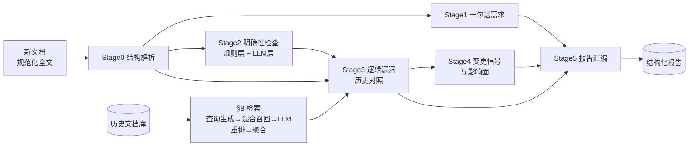
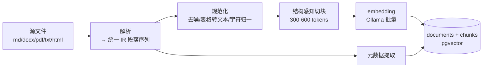

# 先例（Prior）· 产品需求文档

| 项 | 值 |
|---|---|
| 轮次 | 第 2 轮 / 共 5 轮 |
| 版本 | v0.2 |
| 日期 | 2026-10-15 |
| 状态 | 待评审 |
| 聚焦 | 核心引擎深化：发现分类体系、五阶段分析流水线、混合检索、入库管线、报告信息架构 |

## 本轮变更说明

相对 v0.1：

- §6 功能清单从模块级展开为编号功能点（F1.1…F6.4），每项带输入输出与验收要点。
- 新增 §7 分析引擎规格：**发现（finding）统一结构**、四类发现分类、严重度定义、五阶段流水线（每阶段输入/输出/prompt 要点/输出约束）、运行控制（进度/取消/重跑/降级）。
- 新增 §8 检索规格：解决 v0.1 的 Q2——"相似 ≠ 相关"，采用 查询生成 → 混合召回 → LLM 重排 → 文档聚合 四级策略。
- 新增 §9 入库管线规格：解析 IR、规范化、结构感知切块规则、embedding 批量策略、两级去重。
- 新增 §10 报告信息架构与导出格式。
- 裁决 Q1：LLM 走本地 Ollama（默认 qwen2.5:14b-instruct 级），Provider 抽象预留云端，v1 只做本地。
- §1~§5、§11~§14 沿用 v0.1，仅按新编号顺延与微调。

## 1. 背景与问题

产品同学撰写或更新需求文档时，脑中携带大量未落笔的上下文：某个字段的历史口径、某条流程曾经的兜底分支、某次"全部改为 X"对存量数据的影响。这些隐性上下文不会写进新文档，开发按字面实现，于是产生纰漏：

- 新文档覆盖或推翻旧逻辑，但不说明对存量数据、存量接口、灰度回滚的影响；
- 新文档只写主流程，边界条件、异常分支、权限、并发口径缺失；
- "优化""尽快""批量"这类无量纲表述直接进开发，验收时各说各话；
- 历史文档散落在本地文件夹、网盘、Wiki，无人结构化维护，同样的坑反复踩。

同时，组织里沉淀的大量历史需求文档是宝贵资产，却从未被系统性利用。

## 2. 产品定位

- 产品名：**先例（Prior）**——新文档先对照历史先例，再进入开发。
- 一句话定义：一个**本地运行的个人桌面 Agent**，把历史需求文档建成可检索的知识库；新产品文档提交时，自动检索相关历史文档并交叉比对，输出四类结果——逻辑漏洞、不明确的细节、一句话需求清单、变更信号与影响面。
- 价值主张：把产品脑中的隐性历史上下文，变成显性的、带原文证据的问题清单；把"开发纰漏"从编码阶段前移到文档评审阶段拦截。

## 3. 目标与非目标

**目标（v1 必须达成）**

- G1 支持将历史需求文档批量导入本地知识库，可靠去重，可搜索。
- G2 新文档上传后自动完成：结构解析 → 检索相关历史文档 → 交叉分析 → 生成带证据的报告。
- G3 报告覆盖四类发现：逻辑漏洞、不明确项、一句话需求、变更信号。
- G4 全流程本地运行，文档数据不出本机（隐私红线）。

**非目标（v1 明确不做）**

- 不识别扫描件 PDF 的 OCR（v1 标记为不可导入并提示原因，v2 评估）。
- 不自动改写/修订文档正文，只给建议与问题。
- 不做团队协作、在线服务化部署、账号权限体系（v1 单机单用户）。
- 不做需求全生命周期管理（不追踪 Jira/排期/状态）。
- 不生成代码或接口文档。

## 4. 用户角色

| 角色 | 描述 | 核心诉求 |
|---|---|---|
| 主要用户：产品经理 | 写文档的人，历史上下文的携带者 | 发文前自查逻辑漏洞与不明确点，评审会上能被证据直面质疑 |
| 次要用户：开发负责人 | 按文档实现的人 | 拿到"变更影响面"和"边界口径"清单，减少返工与纰漏 |
| 次要用户：测试 | 设计用例的人 | 从"一句话需求"快速派生验收点 |

v1 面向单用户（本机使用者），不区分组织内的操作角色。

## 5. 核心场景

**C1 建库（一次性，之后增量维护）**
PM 打开桌面 App →「文档库」页拖入历史 PRD 文件夹（约 50 篇，md/docx/pdf）→ 后台解析、切块、embedding、入库 → 展示每篇文档的解析状态、字数、分块数 → 重复文档被识别并提示处理。

**C2 分析（日常）**
PM 收到新的产品文档 →「分析台」拖入 → 选择分析范围（全库 / 指定产品线）→ 点「开始分析」→ 阶段化进度实时可见（解析 → 检索 → 逐阶段分析）→ 完成后系统通知 → 点击直达报告。

**C3 消费与反馈**
报告顶部是「变更信号」（如文档中写"之前的逻辑全部不要了，全部改为 X"）及其影响清单；往下是「逻辑漏洞」（附历史文档证据对照）与「不明确项」（附建议向产品提的问题）；「一句话需求」可勾选生成评审清单；PM 对每条发现点「确认 / 误报」，误报样本沉淀供质量改进 → 导出 Markdown 发到评审群。

## 6. 功能清单（展开为编号功能点）

### F1 文档库

| 编号 | 功能 | 规则与验收要点 |
|---|---|---|
| F1.1 | 导入 | 文件/文件夹/zip；格式 md/docx/pdf/txt/html；导入走队列，逐篇显示进度与结果 |
| F1.2 | 解析与切块 | 按 §9 管线执行；导入结果展示：字数、分块数、解析质量标记 |
| F1.3 | 去重 | checksum 相同直接跳过；高相似（>0.95）弹窗让用户选择"仍入库 / 作为新版本 / 取消" |
| F1.4 | 元数据 | 标题、产品线、业务域、版本、作者、状态（active/superseded/draft）；可编辑 |
| F1.5 | 浏览与搜索 | 关键词 + 产品线筛选；原文预览 + 分块预览（heading_path 可见） |
| F1.6 | 删除 | 级联删除其分块；引用了该文档的既有 finding 保留，证据标记"源已删除" |

### F2 检索

| 编号 | 功能 | 规则与验收要点 |
|---|---|---|
| F2.1 | 查询生成 | 从新文档提取章节主题句、术语实体、全文摘要三类查询，上限 30 条 |
| F2.2 | 混合召回 | 向量 topK=50（cosine）+ 关键词（tsvector/trgm），RRF 融合，保留 topM=200 chunk |
| F2.3 | LLM 重排 | 逐 chunk 判断"规则级相关性"（0~1），≥0.5 进入候选；按文档聚合 |
| F2.4 | 相关文档与章节定位 | 输出 top 8 相关文档及相关章节（heading_path），供报告展示与人工跳转 |

### F3 分析 Agent

| 编号 | 功能 | 规则与验收要点 |
|---|---|---|
| F3.1 | 一句话需求 | 每条需求规范化为"作为<角色>、我希望<动作>、以便<价值>；约束/验收：…"，编号与原文一一映射 |
| F3.2 | 明确性检查 | 规则层（占位符/空引用/模糊量词/分支缺失/枚举不全/被动无主）+ LLM 层（歧义/隐含假设/边界/口径） |
| F3.3 | 逻辑漏洞 | C1 文档间冲突、C2 覆盖缺口、C3 文档内不一致；每条必须带历史 chunk 证据 |
| F3.4 | 变更信号与影响面 | 检测"推翻/废弃/重写"表述；影响清单覆盖：受影响旧需求、存量数据、接口兼容、灰度回滚、下游通知 |
| F3.5 | 运行控制 | 阶段化进度事件、可取消、可分阶段重跑、单阶段失败降级不丢已产结果 |

### F4 报告

| 编号 | 功能 | 规则与验收要点 |
|---|---|---|
| F4.1 | 生成与查看 | 概览统计 + 分类 Tab + 严重度筛选 + 关键词搜索 |
| F4.2 | 证据对照 | 新文档引文 ↔ 历史文档引文并排，可跳转文档库定位 chunk |
| F4.3 | 反馈 | 每条发现：确认 / 误报 / 待补充文档 / 搁置 + 备注；误报自动入评测池 |
| F4.4 | 导出 | Markdown（人读）、JSON（机读，schema 校验） |
| F4.5 | 问题清单 | "给产品的 N 问"一键复制，可直接贴 IM |

### F5 设置

| 编号 | 功能 | 规则与验收要点 |
|---|---|---|
| F5.1 | Ollama 连接与模型 | 地址配置、已装模型列表、缺失模型的拉取指引 |
| F5.2 | LLM 参数 | 模型选择、温度、上下文长度、超时 |
| F5.3 | PostgreSQL 连接与自检 | DSN、pgvector 扩展检测、版本检测 |
| F5.4 | 数据目录与索引重建 | 更换 embedding 模型/维度时提供一键重建索引任务 |

### F6 桌面外壳

| 编号 | 功能 | 规则与验收要点 |
|---|---|---|
| F6.1 | 窗口与菜单 | 主窗口 + 原生菜单 + 最近文档 |
| F6.2 | 拖拽导入 | 文档拖入窗口即导入/发起分析 |
| F6.3 | 通知 | 分析完成/失败系统通知，点击直达报告 |
| F6.4 | 引导向导 | 首启检测 PG/Ollama 环境，给出安装命令与验证结果 |

## 7. 分析引擎规格

### 7.1 发现（finding）统一结构

所有阶段产出同构 JSON（落库与前端渲染的唯一契约）：

```json
{
  "id": "F-20261015-0031",
  "run_id": 12,
  "type": "logic_gap | ambiguity | one_liner | change_signal",
  "subtype": "conflict | coverage_gap | internal_conflict | quantified_ambiguity | undefined_reference | state_gap | permission_conflict | data_caliber | ...",
  "severity": "S0 | S1 | S2 | S3",
  "confidence": 0.0,
  "title": "≤40 字结论句",
  "detail": "问题解释",
  "new_doc_span": { "quote": "新文档原文片段", "heading_path": ["3.2 会员积分"], "offset": 1234 },
  "evidence": [
    { "doc_id": 7, "chunk_id": 88, "doc_title": "积分规则PRD v2.1", "heading_path": ["积分扣减"], "quote": "历史文档原文片段" }
  ],
  "question": "建议向产品提出的澄清问题（ambiguity/change_signal 必填）",
  "suggested_fix": "建议补充/改写示范（可选）",
  "impact": "影响面描述（change_signal 必填）",
  "status": "open | confirmed | dismissed | needs_doc | deferred",
  "reviewer_note": ""
}
```

硬约束：

- 所有 finding 必须带 `new_doc_span`（新文档原文引用）；
- `logic_gap` / `change_signal` 必须带非空 `evidence`（历史文档证据）；
- `confidence < 0.5` 的 finding 降级为 S3 展示，不进入导出的问题清单默认集。

### 7.2 严重度定义

| 级别 | 含义 | 典型例子 |
|---|---|---|
| S0 阻塞 | 直接导致无法实现或必然返工 | "之前逻辑全部作废改用 X"但无存量数据迁移说明 |
| S1 严重 | 明显逻辑冲突或关键口径缺失，大概率出纰漏 | 新旧文档对同一字段口径不一致且无说明 |
| S2 一般 | 边界/细节不明确，需确认 | 未说明失败重试次数、超时时间 |
| S3 提示 | 表述优化、命名一致性 | 同义术语混用 |

### 7.3 五阶段流水线



**Stage 0 结构解析**
- 输入：新文档规范化全文（IR，见 §9）。
- 输出：`doc_profile`：`{doc_type, sections[], requirement_items[{no, text, heading_path, offset}], glossary[{term, definition, aliases}], stats}`。
- 方法：规则识别需求条目（列表项 / 用户故事句式 / 功能表格行 / 编号标题），术语表由 LLM 抽取并经规则校验（文档中出现 ≥2 次且带定义语）。
- glossary 用于跨文档口径比对，是 Stage3 的前置输入。

**Stage 1 一句话需求（one_liner）**
- 输入：`requirement_items`。
- 输出：每条需求一张需求卡：规范化句 + 四元组（角色/动作/价值/约束）+ 原文映射 + 缺失项标注。
- prompt 要点：保留编号映射；不得改写原意；无法规范化的需求不丢弃，转 `ambiguity` 候选（subtype=unstructured_requirement）。

**Stage 2 明确性检查（ambiguity）**

规则层（确定性、零成本、先跑）：

| 规则 | 模式 | subtype |
|---|---|---|
| 占位符扫描 | `TBD/TODO/待定/待补充/xxx` | placeholder |
| 空引用 | "详见《X》"，X 未随文提供且不在库中 | undefined_reference |
| 模糊量词 | 快速/友好/优化/大量/偶尔/尽快/实时（无量化上下文） | quantified_ambiguity |
| 分支缺失 | 描述了流程但无异常/回滚/空态分支 | missing_branch |
| 枚举不全 | 用"…等"列举业务实体 | incomplete_enumeration |
| 被动无主句 | "会被清理/会被同步"，缺主体或触发条件 | passive_actor |

LLM 层（输入：章节 + 术语表 + 规则命中，输出语义级问题）：
语义歧义、隐含假设、边界条件（并发/时序/异常/空态/权限）、数据口径（时间/金额/精度/单位）、兼容性。
每条输出必填 `question`（给产品的一句话问题），不得输出无 `new_doc_span` 的条目。

**Stage 3 逻辑漏洞（logic_gap）**

输入：§8 检索命中的相关历史文档块 + `doc_profile` + Stage2 输出。

| 编号 | 检查 | 说明 |
|---|---|---|
| C1 | 文档间冲突 | 新规则 vs 历史规则：字段口径/流程分支/权限矩阵/状态流转/计算逻辑 |
| C2 | 覆盖缺口 | 历史存在且强相关、新文档未提及的既有约束 → 标记"需确认是否仍然适用"（不默认是 bug） |
| C3 | 文档内不一致 | 新文档前后矛盾 |

每条 finding 必须带 `evidence`（历史 chunk）、`question`、`severity`。C2 默认 S2，C1 默认 S1，涉及"全部改为"类推翻且无迁移说明的联动 Stage4 升 S0。

**Stage 4 变更信号与影响面（change_signal）**

- 检测模式：正则粗筛（`不再|废弃|下线|之前的逻辑.*不要|全部改为|统一替换|历史.*作废`）+ LLM 确认与归类。
- 输出 `change_signal`：原话 + 被推翻旧需求的定位（历史 doc/chunk）+ 影响清单，五个影响维度逐项检查：

| 维度 | 检查点 |
|---|---|
| 存量数据 | 迁移 / 保留 / 清理策略是否说明 |
| 接口兼容 | 老调用方、协议版本、字段废弃周期 |
| 灰度与回滚 | 切换策略、回滚路径 |
| 下游通知 | 受影响团队/系统是否被列出 |
| 受影响旧需求 | 库中哪些历史需求条目被推翻（定位到 chunk） |

- 缺失维度逐条转 `question`；此类 finding 默认严重度 S0（无存量说明）或 S1（部分说明）。

**Stage 5 报告汇编**
- 输入：各阶段 findings + 检索上下文。
- 输出：`report`：概览统计、按类型分组的 findings、"给产品的 N 问"清单、引用文档清单、run 元数据（模型/耗时/命中文档数）。
- 空结果也必须产出报告（"未发现 X 类问题" + 检索覆盖说明），不允许空报告。

### 7.4 运行控制

- 分阶段可观测：每阶段 start/finish/耗时/产出条数 → 前端进度流。
- 失败隔离：单阶段失败保留已产 findings，报告标注降级原因，允许单阶段重跑。
- 取消：运行中可取消，已产结果保留，状态 `cancelled`。
- 幂等：同一文档重复发起分析各自生成 run，不做隐式覆盖。

## 8. 检索规格（"相关"而非"相似"）

1. **查询生成**：新文档 → 三类查询——(a) 每章节主题句；(b) 术语表核心实体；(c) 全文摘要（≤500 字）。上限 30 条。
2. **混合召回**：每条查询向量 topK=50（cosine）+ 关键词命中（tsvector / pg_trgm），RRF（k=60）融合 → 保留 topM=200 chunk。
3. **LLM 重排**：输入（查询, chunk 摘要）→ 输出 0~1 的规则级相关性（该历史块是否与新文档某需求存在规则约束关系，而非话题相似）；≥0.5 进入候选。
4. **文档聚合**：文档得分 = max(chunk 分) + 0.1 × Σ(其余 chunk 分)；取 top 8 文档及其相关章节。
5. **上下文预算**：每文档进入 Stage3 的内容 ≤ 4000 tokens，按相关度截断，超限时优先保留规则性语句（含"必须/不得/应当/默认/上限"等情态词段落）。

附产物：新文档章节 × 相关文档的相关度矩阵，报告页用于人工快速定位对比区。

## 9. 入库管线规格



1. **解析**：md（AST → 标题层级）；docx（OOXML 段落样式 → 标题/列表/表格）；pdf（文本层）；txt/html（标签剥离）。统一输出 IR：`{type: heading|paragraph|list_item|table, level, text}`。
2. **规范化**：去页眉页脚/页码/控制字符；统一全角半角（可配置）；表格转"行：列 | 列"文本保留可读性。
3. **切块**：按标题层级聚合，目标 300~600 tokens，下界 200、上界 800；重叠策略：每块携带父级标题路径全文 + 上一块末段；记录 `heading_path[]` 与全局序号。
4. **embedding**：Ollama `/api/embed` 批量请求；失败指数退避重试 3 次；记录模型名与维度——换模型必须重建索引（F5.4）。
5. **去重**：一级 checksum 相同 → 跳过；二级 内容相似 >0.95 → 弹窗（仍入库 / 作为新版本 / 取消）。
6. **元数据补全**：导入时可填产品线；未填时 LLM 推断候选值，用户确认后落库。

## 10. 报告信息架构

- **概览**：文档统计、四类发现计数、按严重度分布、run 元数据（模型 / 耗时 / 命中文档）。
- **变更信号区**（置顶，S0 优先）。
- **逻辑漏洞区**：证据对照——新文档引文 ↔ 历史文档引文（文档名 + 章节路径 + 跳转）。
- **不明确区**：每条附 `question`（给产品的问题），可一键复制。
- **一句话需求区**：需求卡——编号 / 规范化句 / 原文 / 缺失项。
- **引用历史文档清单**：点击跳转文档库。
- **操作**：筛选、排序、逐条反馈、导出 Markdown / JSON。

## 11. 约束与假设

- C1 本地优先：PostgreSQL 15+（pgvector ≥ 0.5）与 Ollama 均在本机。
- C2 数据不出本机；v1 仅本地 Ollama（Provider 抽象见第 3 轮）。
- C3 桌面端使用 mygo；后端 Go 1.27+，前端 TypeScript + Bun。
- C4 中文优先，支持中英混排。
- C5 macOS 优先，Windows/Linux 为兼容目标。
- C6 默认模型档位：embedding `bge-m3`（1024 维）或 `nomic-embed-text`（768 维）；LLM `qwen2.5:14b-instruct` 级；16GB+ 内存。

## 12. 成功指标（维持 v0.1）

- 召回质量：相关历史文档人工判定相关率 ≥ 80%。
- 分析质量：报告中真实问题占比 ≥ 70%。
- 时效：10 页文档端到端分析 ≤ 5 分钟。
- 采用度：连续 4 周内部试用。

## 13. 术语表（增补）

| 术语 | 释义 |
|---|---|
| RRF | Reciprocal Rank Fusion，混合召回融合算法 |
| 规则级相关性 | 历史内容与新需求是否存在规则约束关系（区别于话题相似） |
| 影响清单 | 变更信号对应的存量数据/接口/灰度/下游检查表 |

## 14. 开放问题（更新）

| # | 问题 | 状态 |
|---|---|---|
| Q1 | LLM 选型与稳定性 | ✅ 本轮裁决：本地 Ollama + qwen2.5:14b 级；Provider 抽象第 3 轮落实 |
| Q2 | 检索"相关"策略 | ✅ 本轮裁决：混合召回 + LLM 重排（§8） |
| Q3 | 前端形态（web vs 原生 UI） | → 第 3 轮 |
| Q4 | 数据库 schema 与向量维度 | → 第 3 轮 |
| Q5 | 边界与异常清单 | → 第 4 轮 |
| Q6 | 验收标准、里程碑、风险 | → 第 5 轮 |
| Q7 | prompt 版本管理与回归评测 | → 第 5 轮（本轮已埋点：误报入评测池） |
