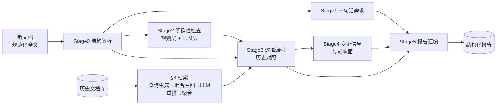
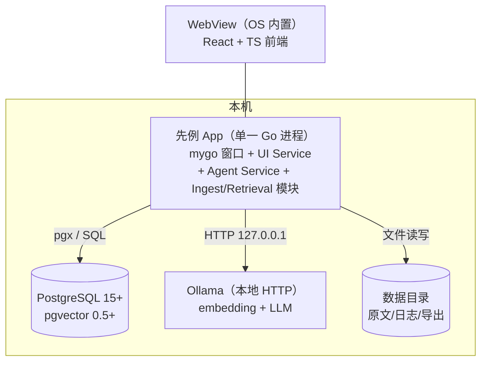

# 先例（Prior）· 产品需求文档

| 项 | 值 |
|---|---|
| 轮次 | 第 3 轮 / 共 5 轮 |
| 版本 | v0.3 |
| 日期 | 2026-10-15 |
| 状态 | 待评审 |
| 聚焦 | 技术定稿：系统架构、pgvector 数据模型、Ollama 接入、后端 API、mygo 前端形态选型、目录结构、配置与日志 |

## 本轮变更说明

相对 v0.2：

- 裁决 Q3：前端采用 **mygo web 前端形态**（webview + React + TS，mygo 生成 TS client），原生对话框/通知/菜单用 mygo desktop API 补齐；给出与原生 UI 形态的对比论证（§15.4）。
- 裁决 Q4：PostgreSQL + pgvector；向量维度跟随 embedding 模型（默认 bge-m3 = 1024 维），换模型必须重建索引。
- 新增 §15 系统架构：单进程桌面 App（Go 进程内嵌全部后端服务），本机 PG + Ollama。
- 新增 §16 数据模型：完整 DDL（documents / chunks / analysis_runs / findings / settings / eval_cases）。
- 新增 §17 后端模块划分与 API：以 `mygo.Bind` 暴露三个 Service（DocLibrary / Analysis / Settings），channel 流式推送进度。
- 新增 §18 Ollama 与 LLM 接入：endpoints、并发与超时、JSON 输出鲁棒性策略、模型建议档位。
- 新增 §19 目录结构（monorepo）与 §20 配置/错误处理/日志。
- §1~§14 内容不变，编号顺延；约束 C3 细化为 Go 1.27+ / Bun 1.x。

## 1. 背景与问题

产品同学撰写或更新需求文档时，脑中携带大量未落笔的上下文：某个字段的历史口径、某条流程曾经的兜底分支、某次"全部改为 X"对存量数据的影响。这些隐性上下文不会写进新文档，开发按字面实现，于是产生纰漏：

- 新文档覆盖或推翻旧逻辑，但不说明对存量数据、存量接口、灰度回滚的影响；
- 新文档只写主流程，边界条件、异常分支、权限、并发口径缺失；
- "优化""尽快""批量"这类无量纲表述直接进开发，验收时各说各话；
- 历史文档散落在本地文件夹、网盘、Wiki，无人结构化维护，同样的坑反复踩。

同时，组织里沉淀的大量历史需求文档是宝贵资产，却从未被系统性利用。

## 2. 产品定位

- 产品名：**先例（Prior）**——新文档先对照历史先例，再进入开发。
- 一句话定义：一个**本地运行的个人桌面 Agent**，把历史需求文档建成可检索的知识库；新产品文档提交时，自动检索相关历史文档并交叉比对，输出四类结果——逻辑漏洞、不明确的细节、一句话需求清单、变更信号与影响面。
- 价值主张：把产品脑中的隐性历史上下文，变成显性的、带原文证据的问题清单；把"开发纰漏"从编码阶段前移到文档评审阶段拦截。

## 3. 目标与非目标

**目标（v1 必须达成）**

- G1 支持将历史需求文档批量导入本地知识库，可靠去重，可搜索。
- G2 新文档上传后自动完成：结构解析 → 检索相关历史文档 → 交叉分析 → 生成带证据的报告。
- G3 报告覆盖四类发现：逻辑漏洞、不明确项、一句话需求、变更信号。
- G4 全流程本地运行，文档数据不出本机（隐私红线）。

**非目标（v1 明确不做）**

- 不识别扫描件 PDF 的 OCR（v1 标记为不可导入并提示原因，v2 评估）。
- 不自动改写/修订文档正文，只给建议与问题。
- 不做团队协作、在线服务化部署、账号权限体系（v1 单机单用户）。
- 不做需求全生命周期管理（不追踪 Jira/排期/状态）。
- 不生成代码或接口文档。

## 4. 用户角色

| 角色 | 描述 | 核心诉求 |
|---|---|---|
| 主要用户：产品经理 | 写文档的人，历史上下文的携带者 | 发文前自查逻辑漏洞与不明确点，评审会上能被证据直面质疑 |
| 次要用户：开发负责人 | 按文档实现的人 | 拿到"变更影响面"和"边界口径"清单，减少返工与纰漏 |
| 次要用户：测试 | 设计用例的人 | 从"一句话需求"快速派生验收点 |

## 5. 核心场景

**C1 建库**：拖入历史 PRD 文件夹（约 50 篇，md/docx/pdf）→ 后台解析/切块/embedding/入库 → 逐篇展示状态与统计 → 重复文档提示处理。

**C2 分析**：拖入新文档 → 选择分析范围（全库 / 指定产品线）→ 开始分析 → 阶段化进度实时可见 → 完成通知 → 直达报告。

**C3 消费与反馈**：报告顶部「变更信号」（如"之前的逻辑全部不要了，全部改为 X"）与影响清单；其下「逻辑漏洞」（附证据对照）与「不明确项」（附给产品的问题）；「一句话需求」可勾选出评审清单；逐条确认/误报 → 导出 Markdown 发评审群。

## 6. 功能清单（编号功能点）

### F1 文档库

| 编号 | 功能 | 规则与验收要点 |
|---|---|---|
| F1.1 | 导入 | 文件/文件夹/zip；格式 md/docx/pdf/txt/html；导入队列 + 逐篇进度 |
| F1.2 | 解析与切块 | 按 §9 管线；展示字数、分块数、解析质量标记 |
| F1.3 | 去重 | checksum 跳过；相似 >0.95 弹窗（仍入库 / 作为新版本 / 取消） |
| F1.4 | 元数据 | 标题、产品线、业务域、版本、作者、状态；可编辑 |
| F1.5 | 浏览与搜索 | 关键词 + 产品线筛选；原文预览 + 分块预览（heading_path 可见） |
| F1.6 | 删除 | 级联删 chunks；既有 finding 保留，证据标记"源已删除" |

### F2 检索

| 编号 | 功能 | 规则与验收要点 |
|---|---|---|
| F2.1 | 查询生成 | 章节主题句 + 术语实体 + 全文摘要，上限 30 条 |
| F2.2 | 混合召回 | 向量 topK=50 + 关键词，RRF 融合，保留 topM=200 chunk |
| F2.3 | LLM 重排 | 规则级相关性 0~1，≥0.5 进候选，按文档聚合 |
| F2.4 | 定位 | top 8 相关文档 + 相关章节（heading_path） |

### F3 分析 Agent

| 编号 | 功能 | 规则与验收要点 |
|---|---|---|
| F3.1 | 一句话需求 | 规范化句 + 四元组 + 原文映射，编号一一对应 |
| F3.2 | 明确性检查 | 规则层六类 + LLM 层五类；每条必带 question |
| F3.3 | 逻辑漏洞 | C1 文档间冲突 / C2 覆盖缺口 / C3 文档内不一致；必带历史证据 |
| F3.4 | 变更信号 | 正则粗筛 + LLM 确认；五维度影响清单 |
| F3.5 | 运行控制 | 阶段进度、取消、分阶段重跑、失败降级 |

### F4 报告

| 编号 | 功能 | 规则与验收要点 |
|---|---|---|
| F4.1 | 生成与查看 | 概览 + 分类 Tab + 严重度筛选 + 搜索 |
| F4.2 | 证据对照 | 新旧引文并排；点击跳文档库定位 chunk |
| F4.3 | 反馈 | 确认 / 误报 / 待补充文档 / 搁置 + 备注；误报入评测池 |
| F4.4 | 导出 | Markdown + JSON（schema 校验） |
| F4.5 | 问题清单 | "给产品的 N 问"一键复制 |

### F5 设置

| 编号 | 功能 | 规则与验收要点 |
|---|---|---|
| F5.1 | Ollama | 地址配置、模型列表、拉取指引 |
| F5.2 | LLM 参数 | 模型、温度、上下文、超时 |
| F5.3 | PostgreSQL | DSN、pgvector 扩展与版本自检 |
| F5.4 | 索引重建 | 换 embedding 模型/维度时一键重建 |

### F6 桌面外壳

| 编号 | 功能 | 规则与验收要点 |
|---|---|---|
| F6.1 | 窗口与菜单 | 主窗口 + 原生菜单 + 最近文档 |
| F6.2 | 拖拽导入 | 拖入即导入/发起分析 |
| F6.3 | 通知 | 完成/失败通知，点击直达报告 |
| F6.4 | 引导向导 | 首启检测 PG/Ollama，给安装命令 |

## 7. 分析引擎规格

### 7.1 发现（finding）统一结构

```json
{
  "id": "F-20261015-0031",
  "run_id": 12,
  "type": "logic_gap | ambiguity | one_liner | change_signal",
  "subtype": "conflict | coverage_gap | internal_conflict | quantified_ambiguity | undefined_reference | state_gap | permission_conflict | data_caliber | ...",
  "severity": "S0 | S1 | S2 | S3",
  "confidence": 0.0,
  "title": "≤40 字结论句",
  "detail": "问题解释",
  "new_doc_span": { "quote": "新文档原文片段", "heading_path": ["3.2 会员积分"], "offset": 1234 },
  "evidence": [
    { "doc_id": 7, "chunk_id": 88, "doc_title": "积分规则PRD v2.1", "heading_path": ["积分扣减"], "quote": "历史文档原文片段" }
  ],
  "question": "建议向产品提出的澄清问题（ambiguity/change_signal 必填）",
  "suggested_fix": "建议补充/改写示范（可选）",
  "impact": "影响面描述（change_signal 必填）",
  "status": "open | confirmed | dismissed | needs_doc | deferred",
  "reviewer_note": ""
}
```

硬约束：所有 finding 带 `new_doc_span`；`logic_gap`/`change_signal` 必须带非空 `evidence`；`confidence < 0.5` 降级 S3 展示。

### 7.2 严重度定义

| 级别 | 含义 | 典型例子 |
|---|---|---|
| S0 阻塞 | 直接导致无法实现或必然返工 | "之前逻辑全部作废改用 X"但无存量数据迁移说明 |
| S1 严重 | 明显逻辑冲突或关键口径缺失 | 新旧文档同一字段口径不一致且无说明 |
| S2 一般 | 边界/细节不明确 | 未说明失败重试次数、超时时间 |
| S3 提示 | 表述优化、命名一致性 | 同义术语混用 |

### 7.3 五阶段流水线



- **Stage 0 结构解析**：新文档 → `doc_profile`（doc_type / sections / requirement_items / glossary / stats）；术语表供 Stage3 口径比对。
- **Stage 1 一句话需求**：每条需求规范化"作为<角色>、我希望<动作>、以便<价值>；约束/验收：…"+ 四元组 + 原文映射；无法规范化的转 ambiguity 候选。
- **Stage 2 明确性检查**：规则层六类（占位符 / 空引用 / 模糊量词 / 分支缺失 / 枚举不全 / 被动无主）+ LLM 层五类（语义歧义 / 隐含假设 / 边界条件 / 数据口径 / 兼容性）；LLM 条目必填 `question`。
- **Stage 3 逻辑漏洞**：C1 文档间冲突（默认 S1）、C2 覆盖缺口（默认 S2，措辞为"需确认是否仍然适用"）、C3 文档内不一致；每条必带历史 chunk 证据。
- **Stage 4 变更信号**：正则粗筛 + LLM 确认；五维度影响清单（存量数据 / 接口兼容 / 灰度回滚 / 下游通知 / 受影响旧需求定位）；缺失维度转 question；默认 S0/S1。
- **Stage 5 报告汇编**：概览 + 分组 findings + "给产品的 N 问" + 引用清单 + run 元数据；空结果也必须产出"未发现"报告。

### 7.4 运行控制

分阶段进度事件；单阶段失败降级不丢已产结果；可取消（状态 cancelled）；可分阶段重跑；重复发起不互相覆盖。

## 8. 检索规格

1. **查询生成**：章节主题句 / 术语实体 / 全文摘要（≤500 字），上限 30 条。
2. **混合召回**：每条查询向量 topK=50（cosine）+ 关键词（tsvector/trgm），RRF(k=60) 融合 → topM=200 chunk。
3. **LLM 重排**：规则级相关性 0~1，≥0.5 进候选。
4. **文档聚合**：文档分 = max(chunk) + 0.1×Σ(其余)；取 top 8 文档 + 相关章节。
5. **上下文预算**：每文档 ≤4000 tokens，按相关度截断，优先保留含情态词（必须/不得/应当/默认/上限）的规则性语句。

## 9. 入库管线规格

IR（`heading|paragraph|list_item|table`）→ 规范化（去页眉页脚/表格转文本/全半角归一）→ 结构感知切块（目标 300~600 tokens，界 200~800，携带父级标题路径与上一块末段）→ Ollama 批量 embedding（退避重试 3 次）→ 入库；checksum / 0.95 相似两级去重；产品线缺失时 LLM 推断候选、用户确认。

## 10. 报告信息架构

概览（统计 + 严重度分布 + run 元数据）→ 变更信号区（置顶）→ 逻辑漏洞区（证据对照）→ 不明确区（附问题）→ 一句话需求区（需求卡）→ 引用文档清单 → 操作（筛选/排序/反馈/导出 MD/JSON）。

## 11. 系统架构



- 单体进程：后端服务与 UI 同进程，`mygo.Bind` 直连，无网络端口（调试模式可选开启）。
- PostgreSQL 与 Ollama 为独立本机服务，通过 127.0.0.1 连接。
- 数据目录（默认 `~/Library/Application Support/Prior/`）存放原文缓存、日志、导出文件。

## 12. 数据模型（PostgreSQL DDL）

```sql
CREATE EXTENSION IF NOT EXISTS vector;      -- pgvector >= 0.5
CREATE EXTENSION IF NOT EXISTS pg_trgm;

CREATE TABLE documents (
  id           BIGSERIAL PRIMARY KEY,
  title        TEXT NOT NULL,
  source_uri   TEXT NOT NULL,                 -- 原始文件路径
  format       TEXT NOT NULL,                 -- md/docx/pdf/txt/html
  doc_type     TEXT NOT NULL DEFAULT 'unknown',
  product_line TEXT,
  author       TEXT,
  version      TEXT,
  status       TEXT NOT NULL DEFAULT 'active',        -- active/superseded/draft
  superseded_by BIGINT REFERENCES documents(id),
  checksum     TEXT NOT NULL,
  char_count   INTEGER NOT NULL DEFAULT 0,
  chunk_count  INTEGER NOT NULL DEFAULT 0,
  embed_model  TEXT,
  created_at   TIMESTAMPTZ NOT NULL DEFAULT now(),
  updated_at   TIMESTAMPTZ NOT NULL DEFAULT now(),
  UNIQUE (checksum)
);
CREATE INDEX idx_documents_status  ON documents(status);
CREATE INDEX idx_documents_product ON documents(product_line);
CREATE INDEX idx_documents_title   ON documents USING gin (title gin_trgm_ops);

CREATE TABLE chunks (
  id           BIGSERIAL PRIMARY KEY,
  doc_id       BIGINT NOT NULL REFERENCES documents(id) ON DELETE CASCADE,
  chunk_index  INTEGER NOT NULL,
  heading_path TEXT[] NOT NULL DEFAULT '{}',
  content      TEXT NOT NULL,
  token_count  INTEGER,
  tsv          TSVECTOR,
  embedding    vector(1024),                  -- 维度随 embed 模型，更换须重建索引
  UNIQUE (doc_id, chunk_index)
);
CREATE INDEX idx_chunks_doc       ON chunks(doc_id);
CREATE INDEX idx_chunks_embedding ON chunks USING hnsw (embedding vector_cosine_ops)
  WITH (m = 16, ef_construction = 64);
CREATE INDEX idx_chunks_tsv       ON chunks USING gin (tsv);

CREATE TABLE analysis_runs (
  id            BIGSERIAL PRIMARY KEY,
  new_doc_id    BIGINT REFERENCES documents(id) ON DELETE SET NULL,
  title         TEXT,
  scope         JSONB NOT NULL DEFAULT '{}',   -- {"product_lines": [], "use_all": true}
  models        JSONB NOT NULL DEFAULT '{}',   -- {"embed": "...", "llm": "...", "params": {...}}
  status        TEXT NOT NULL,                 -- queued/running/succeeded/failed/cancelled
  current_stage TEXT,
  stage_log     JSONB NOT NULL DEFAULT '[]',
  error         TEXT,
  started_at    TIMESTAMPTZ,
  finished_at   TIMESTAMPTZ,
  created_at    TIMESTAMPTZ NOT NULL DEFAULT now()
);
CREATE INDEX idx_runs_status ON analysis_runs(status);

CREATE TABLE findings (
  id            BIGSERIAL PRIMARY KEY,
  run_id        BIGINT NOT NULL REFERENCES analysis_runs(id) ON DELETE CASCADE,
  type          TEXT NOT NULL,                 -- logic_gap/ambiguity/one_liner/change_signal
  subtype       TEXT,
  severity      TEXT NOT NULL,                 -- S0..S3
  confidence    REAL NOT NULL,
  title         TEXT NOT NULL,
  detail        TEXT NOT NULL,
  new_doc_span  JSONB NOT NULL,
  evidence      JSONB NOT NULL DEFAULT '[]',
  question      TEXT,
  suggested_fix TEXT,
  impact        TEXT,
  status        TEXT NOT NULL DEFAULT 'open',  -- open/confirmed/dismissed/needs_doc/deferred
  reviewer_note TEXT,
  created_at    TIMESTAMPTZ NOT NULL DEFAULT now(),
  updated_at    TIMESTAMPTZ NOT NULL DEFAULT now()
);
CREATE INDEX idx_findings_run ON findings(run_id, type, severity);

CREATE TABLE settings (
  key        TEXT PRIMARY KEY,
  value      JSONB NOT NULL,
  updated_at TIMESTAMPTZ NOT NULL DEFAULT now()
);

CREATE TABLE eval_cases (   -- 黄金评测集（第 5 轮启用）
  id         BIGSERIAL PRIMARY KEY,
  name       TEXT NOT NULL,
  source_doc_id BIGINT REFERENCES documents(id) ON DELETE SET NULL,
  gold       JSONB NOT NULL,                   -- 人工标注的预期 findings
  created_at TIMESTAMPTZ NOT NULL DEFAULT now()
);

CREATE TABLE eval_results (
  id          BIGSERIAL PRIMARY KEY,
  case_id     BIGINT NOT NULL REFERENCES eval_cases(id) ON DELETE CASCADE,
  prompt_ver  TEXT NOT NULL,
  precision_p REAL, recall_p REAL,
  detail      JSONB,
  created_at  TIMESTAMPTZ NOT NULL DEFAULT now()
);
```

要点：`documents.checksum` 唯一约束实现一级去重；`chunks.embedding` 为 HNSW 索引；`tsv` 由触发器或应用层写入（中文分词在应用侧完成）；findings 全量 JSONB 契约与 §7.1 一致。

## 13. 后端模块与 API

模块划分（`backend/internal/`）：`config`（配置加载）｜`store`（pgx 数据访问 + migration）｜`ingest`（解析/规范化/切块/去重）｜`embed`（Ollama embedding client）｜`retrieval`（查询生成/混合/重排/聚合）｜`agent`（五阶段 + prompt 管理）｜`report`（汇编/导出）｜`service`（mygo.Bind 服务层）。

服务层 API（前端经 mygo 生成的 TS client 调用）：

```go
type DocLibraryService struct{ /* deps */ }
func (DocLibraryService) List(req ListQuery) ([]DocSummary, error)          // 搜索/筛选/分页
func (DocLibraryService) Import(paths []string) (ImportJob, error)          // 文件/文件夹/zip
func (DocLibraryService) ImportProgress(jobID string) <-chan ImportEvent    // channel 流式
func (DocLibraryService) Get(id int64) (DocDetail, error)                   // 元数据+分块+原文预览
func (DocLibraryService) UpdateMeta(id int64, patch MetaPatch) error
func (DocLibraryService) Delete(id int64) error
func (DocLibraryService) ResolveDuplicate(action DupAction) error           // 仍入库/作为新版本/取消

type AnalysisService struct{ /* deps */ }
func (AnalysisService) Create(docPath string, req AnalyzeReq) (RunHandle, error)
func (AnalysisService) Progress(runID int64) <-chan ProgressEvent           // 阶段/日志/计数
func (AnalysisService) Cancel(runID int64) error
func (AnalysisService) RetryStage(runID int64, stage string) error
func (AnalysisService) Report(runID int64) (Report, error)
func (AnalysisService) Feedback(findingID int64, st Feedback, note string) error
func (AnalysisService) Export(runID int64, format string) (string, error)  // 返回导出文件路径

type SettingsService struct{ /* deps */ }
func (SettingsService) Get() (Settings, error)
func (SettingsService) Update(s Settings) error
func (SettingsService) CheckEnv() (EnvReport, error)                        // PG/Ollama/模型/磁盘
```

`ProgressEvent` 至少含：`stage`、`state(start|finish|log)`、`message`、`counts`（如检索命中文档数）、`elapsed_ms`。

## 14. Ollama 与 LLM 接入

- endpoints：`GET /api/tags`（模型列表）、`POST /api/embed`（批量 embedding）、`POST /api/generate`（`format:"json"`、`options:{temperature, num_ctx, seed}`）。
- 并发：本地推理串行化，队列深度默认 2（LLM）/4（embedding），避免 OOM。
- 超时：embedding 60s、LLM 300s/次；超时按阶段重试 2 次。
- 输出鲁棒性：要求模型输出 JSON 子集；解析失败把错误信息回传重试（最多 2 次），仍失败则该阶段降级并记录。
- 模型档位建议：embedding `bge-m3`（1024 维，中文强）或 `nomic-embed-text`（768 维）；LLM `qwen2.5:14b-instruct` 或 `qwen3:14b`；设置页可切换，切换 embedding 触发 F5.4 索引重建。
- Provider 抽象：`type LLMProvider interface { Embed([]string) ([][]float32, error); Generate(ctx, Prompt) (string, error) }`，v1 仅实现 Ollama；云端 OpenAI 兼容实现留接口不接线（v2 候选，需显式用户授权）。

## 15. 前端规格（mygo）

### 15.1 形态选型（裁决 Q3）

| 维度 | web 前端（webview+TS） | 原生 UI（Go `ui` 包） |
|---|---|---|
| 重度文本渲染（证据对照/高亮/需求卡表格） | ✅ 生态成熟 | ❌ 需自建富文本组件 |
| 筛选/看板交互 | ✅ | 成本高 |
| 与 mygo 能力配合 | typed IPC + TS client 生成 + channel 流式 | 直接 Go |
| 启动速度/内存 | webview 较重 | 更轻 |
| 人员上手 | 前端同学可参与 | 仅 Go |

**决定：web 前端（webview + React + Vite + Bun）**；原生能力（文件对话框、拖拽、系统通知、菜单、最近文档）用 mygo desktop API 补齐；窗口使用系统原生边框保桌面感。

### 15.2 页面信息架构

- `/docs` 文档库：列表（搜索/筛选/排序）+ 导入（按钮 + 拖拽）+ 详情（元数据/分块/原文）
- `/analyze` 分析台：拖拽区 + 范围配置 + 进度流（stepper + 实时日志）+ 取消
- `/report/:runId` 报告：概览卡 + 分类 Tab + finding 卡片（证据对照/反馈/复制）+ 导出
- `/history` 历史分析：run 列表（状态/耗时/发现数）+ 重开/重跑
- `/settings` 设置：Ollama / LLM 参数 / PG / 数据目录 / 索引重建 / 环境自检

### 15.3 前后端契约

- 所有 Go 服务经 `mygo.Bind` 暴露，生成 `mygo.ts`，前端强类型调用。
- 进度/导入走 channel（`<-chan`），前端订阅渲染，断线重订阅。
- 文档原文预览由后端分页提供（不把整库原文塞进前端）。

## 16. 目录结构

```
prd_viewer/
  prd/                      # 需求文档（本目录）
  backend/
    cmd/app/main.go         # 启动：配置 → migration → service → mygo App
    internal/{config,store,ingest,embed,retrieval,agent,report,service}
    migrations/001_init.sql
    prompts/                # 五阶段 prompt 模板（版本化，入 git）
  frontend/
    src/{pages,components,api}  package.json  vite.config.ts
  scripts/
    setup-mac.sh            # 安装/校验 PG+pgvector、拉取 Ollama 模型
    docker-compose.yml      # 可选：PG 容器化
  docs/                     # 使用说明
```

## 17. 配置、错误处理与日志

- 配置文件 `config.yaml`（PG DSN、Ollama base_url、模型、数据目录、并发/超时）；UI 设置覆盖写 `settings` 表，优先级高于文件。
- 错误分层：用户可读中文 message + 机器码；服务层错误映射为前端 toast，不弹堆栈。
- 日志：结构化（slog）落数据目录 `logs/`；默认只记 id/长度/checksum，**不记文档原文**（脱敏红线）。

## 18. 成功指标（维持）

召回相关率 ≥80%；真实问题占比 ≥70%；10 页分析 ≤5 分钟；连续 4 周内部试用。

## 19. 术语表（增补）

| 术语 | 释义 |
|---|---|
| IR | 入库管线的统一中间表示（段落序列） |
| Provider 抽象 | LLM/embedding 后端可替换接口，v1 仅 Ollama 实现 |
| channel | mygo typed IPC 的流式通道，用于进度推送 |

## 20. 开放问题（更新）

| # | 问题 | 状态 |
|---|---|---|
| Q1/Q2 | LLM 选型、检索策略 | ✅ v0.2 裁决 |
| Q3 前端形态 | ✅ 本轮裁决：webview + React |
| Q4 schema | ✅ 本轮裁决：pgvector，维度随模型，默认 1024 |
| Q5 边界与异常清单 | → 第 4 轮 |
| Q6 验收标准/里程碑/风险 | → 第 5 轮 |
| Q7 prompt 版本管理与回归评测 | → 第 5 轮（eval_cases/eval_results 表已预留） |
