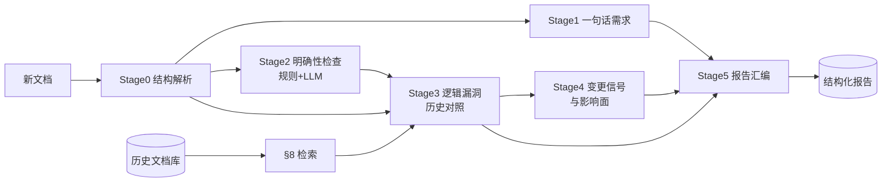
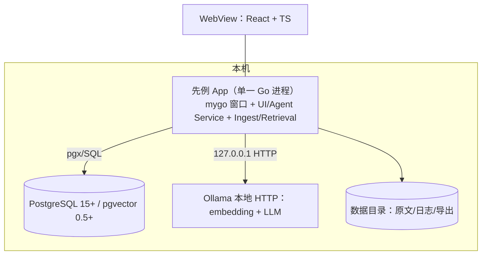

# 先例（Prior）· 产品需求文档

| 项 | 值 |
|---|---|
| 轮次 | 第 4 轮 / 共 5 轮 |
| 版本 | v0.4 |
| 日期 | 2026-10-15 |
| 状态 | 待评审 |
| 聚焦 | 逐页交互规格、异常与边界矩阵、性能预算、安全与隐私、兼容性 |

## 本轮变更说明

相对 v0.3（裁决 Q5 边界清单）：

- §1~§20 技术规格不变；为保持单文件可读性，部分表格做了等义压缩，**所有数值/规则/契约不变**。
- 新增 §21 交互规格：五个页面的信息架构、关键交互细节、状态与空态。
- 新增 §22 异常与边界矩阵：16 类场景的确定行为（环境缺失、扫描件、大文件、取消、模型更换、删除引用等）。
- 新增 §23 性能与资源预算（可测指标）。
- 新增 §24 安全与隐私：本地绑定、日志脱敏、数据清空。
- 新增 §25 兼容性矩阵（PG / Ollama / 模型 / OS / 工具链）。
- §26 开放问题更新：仅剩 Q6、Q7 进第 5 轮。

## 1. 背景与问题

产品同学脑中携带大量未落笔的上下文（历史字段口径、曾经的兜底分支、"全部改为 X"的迁移影响），新文档按字面实现即产生纰漏；历史文档散落各地，同样的问题反复出现。先例把隐性历史上下文变成显性的、带证据的问题清单，在文档评审阶段拦截纰漏。

## 2. 产品定位

**先例（Prior）**：本地运行的个人桌面 Agent——历史需求文档建成向量知识库；新文档自动检索相关历史文档并交叉比对，输出四类发现：逻辑漏洞、不明确的细节、一句话需求、变更信号与影响面。核心价值：把"开发纰漏"前移到"文档评审"。

## 3. 目标与非目标

**目标（v1）**：G1 批量导入历史文档、可靠去重、可搜索；G2 新文档自动完成"解析→检索→交叉分析→带证据报告"；G3 报告覆盖四类发现；G4 全流程本地运行，数据不出本机。

**非目标（v1）**：扫描件 OCR；自动改写文档；团队协作/在线部署/账号权限；需求生命周期管理（Jira 追踪）；代码/接口文档生成。

## 4. 用户角色

| 角色 | 核心诉求 |
|---|---|
| 主要：产品经理 | 发文前自查漏洞与不明确点，评审会上被证据直面质疑 |
| 次要：开发负责人 | 变更影响面 + 边界口径清单，减少返工 |
| 次要：测试 | 从一句话需求派生验收点 |

v1 单机单用户，不区分组织操作角色。

## 5. 核心场景

**C1 建库**：拖入约 50 篇历史 PRD → 解析/切块/embedding/入库 → 逐篇状态与统计 → 重复提示。
**C2 分析**：拖入新文档 → 选范围（全库/产品线）→ 开始 → 阶段进度流 → 通知 → 直达报告。
**C3 消费反馈**：报告顶部变更信号（"之前的逻辑全部不要了，全部改为 X"）与影响清单；其下逻辑漏洞（证据对照）与不明确项（给产品的问题）；一句话需求勾选出评审清单；逐条确认/误报 → 导出 Markdown 发群。

## 6. 功能清单（编号功能点）

**F1 文档库**：F1.1 导入（文件/文件夹/zip，md/docx/pdf/txt/html，队列+进度）；F1.2 解析切块（字数/分块数/质量标记）；F1.3 去重（checksum 跳过；>0.95 弹窗：仍入库/作为新版本/取消）；F1.4 元数据编辑；F1.5 浏览搜索（关键词+产品线；原文+分块预览）；F1.6 删除（级联 chunks；旧 finding 证据标"源已删除"）。

**F2 检索**：F2.1 查询生成（章节主题句/术语实体/摘要，≤30 条）；F2.2 混合召回（向量 topK=50 + 关键词，RRF k=60 → topM=200）；F2.3 LLM 重排（规则级相关 0~1，≥0.5）；F2.4 定位（top 8 文档 + 相关章节）。

**F3 分析 Agent**：F3.1 一句话需求（规范化句+四元组+原文映射）；F3.2 明确性检查（规则六类+LLM 五类，必带 question）；F3.3 逻辑漏洞（C1 文档间冲突 S1 / C2 覆盖缺口 S2 / C3 文档内不一致，必带历史证据）；F3.4 变更信号（正则+LLM 确认，五维影响清单）；F3.5 运行控制（进度/取消/分阶段重跑/降级）。

**F4 报告**：F4.1 概览+分类 Tab+严重度筛选+搜索；F4.2 证据对照（新旧引文并排，跳转定位）；F4.3 反馈（确认/误报/待补充/搁置+备注，误报入评测池）；F4.4 导出 MD/JSON；F4.5 "给产品的 N 问"一键复制。

**F5 设置**：F5.1 Ollama（地址/模型/拉取指引）；F5.2 LLM 参数；F5.3 PG 连接自检（扩展+版本）；F5.4 索引重建（换 embedding 模型/维度时）。

**F6 桌面外壳**：F6.1 窗口/菜单/最近文档；F6.2 拖拽导入；F6.3 完成通知；F6.4 首启引导向导（PG/Ollama 检测+安装命令）。

## 7. 分析引擎规格

### 7.1 发现（finding）统一结构（契约，落库与前端渲染唯一依据）

```json
{
  "id": "F-20261015-0031",
  "run_id": 12,
  "type": "logic_gap | ambiguity | one_liner | change_signal",
  "subtype": "conflict | coverage_gap | internal_conflict | quantified_ambiguity | undefined_reference | state_gap | permission_conflict | data_caliber",
  "severity": "S0 | S1 | S2 | S3",
  "confidence": 0.0,
  "title": "≤40 字结论句",
  "detail": "问题解释",
  "new_doc_span": { "quote": "新文档原文片段", "heading_path": ["3.2 会员积分"], "offset": 1234 },
  "evidence": [
    { "doc_id": 7, "chunk_id": 88, "doc_title": "积分规则PRD v2.1", "heading_path": ["积分扣减"], "quote": "历史文档原文片段" }
  ],
  "question": "建议向产品提出的澄清问题（ambiguity/change_signal 必填）",
  "suggested_fix": "建议补充/改写示范（可选）",
  "impact": "影响面描述（change_signal 必填）",
  "status": "open | confirmed | dismissed | needs_doc | deferred",
  "reviewer_note": ""
}
```

硬约束：所有 finding 带 `new_doc_span`；`logic_gap`/`change_signal` 必带非空 `evidence`；`confidence<0.5` 降级 S3。

### 7.2 严重度

| 级别 | 含义 | 例子 |
|---|---|---|
| S0 | 阻塞：无法实现或必然返工 | "之前逻辑全部作废改用 X"无存量迁移说明 |
| S1 | 严重：明显冲突或关键口径缺失 | 新旧字段口径不一致且无说明 |
| S2 | 一般：边界/细节待确认 | 未说明重试次数、超时 |
| S3 | 提示：表述/命名 | 同义术语混用 |

### 7.3 五阶段流水线



- **S0 结构解析**：输出 `doc_profile`（doc_type / sections / requirement_items / glossary / stats）；glossary 供口径比对。
- **S1 一句话需求**："作为<角色>、我希望<动作>、以便<价值>；约束/验收：…"+ 四元组 + 原文映射；无法规范化的转 ambiguity。
- **S2 明确性检查**：规则层六类——占位符（TBD/TODO/待定/xxx）、空引用、模糊量词（快速/友好/优化/大量/尽快/实时）、分支缺失、枚举不全（"…等"）、被动无主句；LLM 层五类——语义歧义、隐含假设、边界条件（并发/时序/异常/空态/权限）、数据口径（时间/金额/精度/单位）、兼容性；LLM 条目必填 `question`。
- **S3 逻辑漏洞**：C1 文档间冲突（口径/分支/权限/状态流转/计算逻辑，默认 S1）；C2 覆盖缺口（历史强相关但新文档未提 → "需确认是否仍然适用"，S2）；C3 文档内不一致。每条必带历史 chunk 证据。
- **S4 变更信号**：正则粗筛（`不再|废弃|下线|之前的逻辑.*不要|全部改为|统一替换|历史.*作废`）+ LLM 确认；五维影响清单——存量数据、接口兼容、灰度回滚、下游通知、受影响旧需求定位；缺失维度转 `question`；默认 S0/S1。
- **S5 报告汇编**：概览 + 分组 findings + "给产品的 N 问" + 引用清单 + run 元数据；空结果也必须产出"未发现"报告。

### 7.4 运行控制

分阶段进度事件；单阶段失败降级保留已产结果；可取消（cancelled）；可分阶段重跑；重复发起互不覆盖。

## 8. 检索规格

查询生成（≤30）→ 混合召回（向量 topK=50 + 关键词，RRF k=60 → topM=200）→ LLM 重排（规则级相关性 ≥0.5）→ 文档聚合（分 = max + 0.1×Σ其余，top 8）→ 上下文预算每文档 ≤4000 tokens，优先保留含情态词（必须/不得/应当/默认/上限）的规则性语句。附：章节 × 文档相关度矩阵（报告页可视化）。

## 9. 入库管线规格

md（AST）/docx（OOXML）/pdf（文本层）/txt/html → 统一 IR（heading/paragraph/list_item/table）→ 规范化（去页眉页脚、表格转文本、全半角归一）→ 结构感知切块（目标 300~600 tokens，界 200~800，携带父级标题路径 + 上一块末段）→ Ollama 批量 embedding（退避重试 3 次）→ 入库；checksum / 0.95 相似两级去重；产品线缺失时 LLM 推断候选、用户确认。

## 10. 报告信息架构

概览（四类计数 + 严重度分布 + run 元数据）→ 变更信号区（置顶）→ 逻辑漏洞区（证据对照）→ 不明确区（附问题）→ 一句话需求区（需求卡）→ 引用文档清单 → 操作（筛选/排序/反馈/导出）。

## 11. 系统架构



单体进程、无对外端口（调试模式可选）；PG/Ollama 经 127.0.0.1 连接；数据目录默认 `~/Library/Application Support/Prior/`。

## 12. 数据模型（DDL）

```sql
CREATE EXTENSION IF NOT EXISTS vector;
CREATE EXTENSION IF NOT EXISTS pg_trgm;

CREATE TABLE documents (
  id BIGSERIAL PRIMARY KEY,
  title TEXT NOT NULL, source_uri TEXT NOT NULL, format TEXT NOT NULL,
  doc_type TEXT NOT NULL DEFAULT 'unknown', product_line TEXT, author TEXT, version TEXT,
  status TEXT NOT NULL DEFAULT 'active', superseded_by BIGINT REFERENCES documents(id),
  checksum TEXT NOT NULL, char_count INTEGER NOT NULL DEFAULT 0,
  chunk_count INTEGER NOT NULL DEFAULT 0, embed_model TEXT,
  created_at TIMESTAMPTZ NOT NULL DEFAULT now(), updated_at TIMESTAMPTZ NOT NULL DEFAULT now(),
  UNIQUE (checksum)
);
CREATE INDEX idx_documents_status ON documents(status);
CREATE INDEX idx_documents_product ON documents(product_line);
CREATE INDEX idx_documents_title ON documents USING gin (title gin_trgm_ops);

CREATE TABLE chunks (
  id BIGSERIAL PRIMARY KEY,
  doc_id BIGINT NOT NULL REFERENCES documents(id) ON DELETE CASCADE,
  chunk_index INTEGER NOT NULL, heading_path TEXT[] NOT NULL DEFAULT '{}',
  content TEXT NOT NULL, token_count INTEGER, tsv TSVECTOR,
  embedding vector(1024),
  UNIQUE (doc_id, chunk_index)
);
CREATE INDEX idx_chunks_doc ON chunks(doc_id);
CREATE INDEX idx_chunks_embedding ON chunks USING hnsw (embedding vector_cosine_ops) WITH (m=16, ef_construction=64);
CREATE INDEX idx_chunks_tsv ON chunks USING gin (tsv);

CREATE TABLE analysis_runs (
  id BIGSERIAL PRIMARY KEY, new_doc_id BIGINT REFERENCES documents(id) ON DELETE SET NULL,
  title TEXT, scope JSONB NOT NULL DEFAULT '{}', models JSONB NOT NULL DEFAULT '{}',
  status TEXT NOT NULL, current_stage TEXT, stage_log JSONB NOT NULL DEFAULT '[]',
  error TEXT, started_at TIMESTAMPTZ, finished_at TIMESTAMPTZ,
  created_at TIMESTAMPTZ NOT NULL DEFAULT now()
);
CREATE INDEX idx_runs_status ON analysis_runs(status);

CREATE TABLE findings (
  id BIGSERIAL PRIMARY KEY,
  run_id BIGINT NOT NULL REFERENCES analysis_runs(id) ON DELETE CASCADE,
  type TEXT NOT NULL, subtype TEXT, severity TEXT NOT NULL, confidence REAL NOT NULL,
  title TEXT NOT NULL, detail TEXT NOT NULL, new_doc_span JSONB NOT NULL,
  evidence JSONB NOT NULL DEFAULT '[]', question TEXT, suggested_fix TEXT, impact TEXT,
  status TEXT NOT NULL DEFAULT 'open', reviewer_note TEXT,
  created_at TIMESTAMPTZ NOT NULL DEFAULT now(), updated_at TIMESTAMPTZ NOT NULL DEFAULT now()
);
CREATE INDEX idx_findings_run ON findings(run_id, type, severity);

CREATE TABLE settings (key TEXT PRIMARY KEY, value JSONB NOT NULL, updated_at TIMESTAMPTZ NOT NULL DEFAULT now());

CREATE TABLE eval_cases (
  id BIGSERIAL PRIMARY KEY, name TEXT NOT NULL,
  source_doc_id BIGINT REFERENCES documents(id) ON DELETE SET NULL,
  gold JSONB NOT NULL, created_at TIMESTAMPTZ NOT NULL DEFAULT now()
);
CREATE TABLE eval_results (
  id BIGSERIAL PRIMARY KEY, case_id BIGINT NOT NULL REFERENCES eval_cases(id) ON DELETE CASCADE,
  prompt_ver TEXT NOT NULL, precision_p REAL, recall_p REAL, detail JSONB,
  created_at TIMESTAMPTZ NOT NULL DEFAULT now()
);
```

要点：checksum 唯一约束 = 一级去重；HNSW 向量索引；`tsv` 应用侧写入（中文分词在应用侧）；findings JSONB 契约 = §7.1。

## 13. 后端模块与 API

`backend/internal/`：config / store / ingest / embed / retrieval / agent / report / service。服务层经 `mygo.Bind` 暴露：**DocLibraryService**（List / Import / ImportProgress(chan) / Get / UpdateMeta / Delete / ResolveDuplicate）；**AnalysisService**（Create / Progress(chan) / Cancel / RetryStage / Report / Feedback / Export）；**SettingsService**（Get / Update / CheckEnv）。`ProgressEvent`：stage、state(start|finish|log)、message、counts、elapsed_ms。

## 14. Ollama 与 LLM 接入

endpoints `GET /api/tags`、`POST /api/embed`、`POST /api/generate`（format:json + options）；推理串行化，队列 LLM 2 / embed 4；超时 embed 60s / LLM 300s，阶段重试 2 次；JSON 解析失败回传错误重试 ≤2 次，仍败则降级。模型档位：`bge-m3`(1024) 或 `nomic-embed-text`(768)；`qwen2.5:14b-instruct` / `qwen3:14b`。Provider 抽象 `LLMProvider{Embed, Generate}`，v1 仅 Ollama。

## 15. 前端规格（mygo）

webview + React + Vite + Bun（原生能力用 mygo desktop API：对话框/拖拽/通知/菜单/最近文档）。页面：`/docs` 文档库、`/analyze` 分析台、`/report/:runId`、`/history`、`/settings`。契约：`mygo.Bind` 生成 TS client；进度走 channel；原文预览后端分页提供。

## 16. 目录结构

```
prd_viewer/
  prd/  backend/{cmd/app,internal/{config,store,ingest,embed,retrieval,agent,report,service},migrations,prompts}
  frontend/src/{pages,components,api}
  scripts/{setup-mac.sh,docker-compose.yml}
  docs/
```

## 17. 配置、错误处理与日志

`config.yaml`（PG DSN / Ollama base_url / 模型 / 数据目录 / 并发超时）；UI 设置写 settings 表，优先于文件。错误分层（用户可读中文 message + 机器码）；slog 结构化日志落数据目录，默认不记文档原文。

## 18. 成功指标（维持）

召回相关率 ≥80%；真实问题占比 ≥70%；10 页分析 ≤5 分钟；连续 4 周内部试用。

## 19. 术语表（增补）

IR（统一中间表示）；Provider 抽象；channel（mygo typed IPC 流式通道）。

## 20. 开放问题（更新）

Q5 → ✅ 本轮 §22 裁决；Q6/Q7 → 第 5 轮。

## 21. 交互规格（逐页）

### 21.1 文档库 `/docs`

- 顶部：导入按钮（文件对话框 / 文件夹 / zip）+ 拖拽区；筛选（产品线 chips + 格式 + 状态）+ 关键词搜索 + 排序（导入时间/标题）。
- 列表行：标题、格式图标、产品线、字数/分块数、状态徽标（active/superseded/draft/解析失败）、导入时间。
- 导入进行中：行内进度条（解析→切块→embedding→入库）；失败行展示原因 + 重试。
- 详情抽屉：元数据（可编辑）+ 分块列表（heading_path 面包屑 + token 数，点击高亮定位原文）+ 原文预览（分页）。
- 去重弹窗：并排对比相似度、checksum、来源路径；按钮：仍入库 / 作为新版本 / 取消。

### 21.2 分析台 `/analyze`

- 拖拽区支持多文件（队列依次分析）；配置文件卡片：项目名（可选）、范围（产品线 chips，未选 = 全库）、模型（默认设置页所选）、完成后通知开关。
- 点击「开始分析」→ 进度流：阶段 stepper（解析 → 检索 → S1~S5）+ 当前阶段实时日志（"检索命中 6 篇文档，最强相关：《积分规则 v2.1》"、"S3 产出 12 条"）+ 取消按钮。
- 失败态：阶段红点 + 降级说明 + 「重跑该阶段 / 重跑全部」。
- 完成后：系统通知（标题 = 文档名，正文 = 发现计数摘要），点击直达报告。

### 21.3 报告 `/report/:runId`

- 概览卡：四类发现计数 + 严重度分布（S0/S1/S2/S3）+ run 元数据（模型 / 耗时 / 命中文档 / 覆盖章节矩阵迷你热力图）。
- Tab：变更信号（置顶）｜逻辑漏洞｜不明确｜一句话需求；每 Tab 内：严重度筛选 + 关键词搜索 + 排序（严重度/置信度）。
- Finding 卡片：类型角标 + 严重度色点 + title + detail + 置信度；证据区 = 新文档引文（灰底引文块，命中词高亮）↔ 历史文档引文（文档名 + heading_path 面包屑 + 跳转按钮）；question 区可一键复制；操作：确认 / 误报 / 待补充文档 / 搁置 + 备注输入。
- 一句话需求区：需求卡表格（编号 / 规范化句 / 原文折叠 / 缺失项角标）；可勾选 → 「生成评审清单」导出。
- 空态：该 Tab 无发现时显示"未发现 X 类问题"+ 检索覆盖说明（命中文档数、预算截断提示）。
- 导出：Markdown / JSON；导出成功后按钮变"打开文件"。

### 21.4 历史 `/history`

- run 列表：文档名、状态、开始时间、耗时、四类计数；操作：打开报告 / 重跑 / 删除。
- 失败/取消 run 保留已产 findings，标记"部分结果"。

### 21.5 设置 `/settings`

- Ollama：地址输入 + 连接测试 + 已装模型列表 + 缺失模型一键展示 `ollama pull` 命令。
- LLM：模型下拉、温度、num_ctx、超时；保存即时生效（下一次分析）。
- PostgreSQL：DSN + 自检（连接 / pgvector 版本 / 表结构 migration 状态）。
- 数据：数据目录路径（可改，改时提示迁移）、重建向量索引（任务化 + 进度）、清空全部数据（二次确认，需输入"DELETE"）。
- 首启向导：四步（PG 检测 → Ollama 检测 → 模型检测 → 数据目录），每步给命令与"重新检测"。

## 22. 异常与边界矩阵

| # | 场景 | 行为 |
|---|---|---|
| B1 | 空文档 / <100 字符 | 拒绝导入/分析，提示原因 |
| B2 | 扫描版 PDF（文本层 <100 字符/页） | 标记 needs_ocr，v1 不支持，提示转文字版或 v2 OCR |
| B3 | 重复文件（checksum 相同） | 跳过并在导入结果中列出，不重复入库 |
| B4 | 高相似（>0.95） | 弹窗：仍入库 / 作为新版本 / 取消 |
| B5 | 大文件（>10MB 或 >500 页） | 允许导入但走后台队列；分析前提示建议按章节拆分 |
| B6 | 非中文为主文档 | 允许（bge-m3 多语言兜底），提示质量可能下降 |
| B7 | Ollama 未启动 / 模型缺失 | 导入或分析前置检查失败，引导页给出安装/拉取命令 |
| B8 | PG 未启动 / 缺 pgvector 扩展 | 同上，提供 docker-compose 与验证 SQL |
| B9 | 分析中 LLM 超时/崩溃 | 阶段重试 2 次；仍败 → 该阶段降级，其他阶段结果保留，报告标注降级 |
| B10 | 用户取消分析 | status=cancelled，已产 findings 保留，可重跑 |
| B11 | 更换 embedding 模型/维度 | 设置页提示需重建索引，提供任务化一键重建（重建期间停止新分析） |
| B12 | 删除被引用的历史文档 | chunks 级联删除；既有 findings 保留，evidence 标记"源已删除" |
| B13 | 导出写入失败（磁盘/权限） | 明确错误 + 重试；不静默吞错 |
| B14 | 多文档同时导入 | 队列串行 + 总体进度；避免 GPU 争抢 |
| B15 | findings 解析 JSON 失败 | 回传错误信息重试 ≤2 次 → 阶段降级并记录 prompt_ver |
| B16 | 设置页配置错误（坏地址/模型名） | 保存时校验并提示，不影响已存数据与分析记录 |

## 23. 性能与资源预算

| 指标 | 预算 |
|---|---|
| 导入 30 页 PRD（约 1.5 万字） | ≤ 90s（含 embedding） |
| 检索（top 8 文档） | ≤ 2s（不含 LLM 重排）；LLM 重排 200 chunk ≤ 60s |
| 分析 10 页文档 端到端 | ≤ 5 min |
| 分析 30 页文档 端到端 | ≤ 12 min |
| 报告渲染（≤100 findings） | ≤ 1s |
| App 常驻内存 | ≤ 300MB |
| PostgreSQL 内存 | ≤ 1GB |
| 磁盘 | 每 1000 chunk ≈ 4MB（1024 维 float4 向量）+ 原文 |

超预算即视为缺陷，进入第 5 轮验收（AC12）。

## 24. 安全与隐私 

- 服务仅绑定 127.0.0.1，不开网络监听（调试模式显式开关，默认关）。
- 文档、分块、prompt 不出本机（v1 仅本地 Ollama）。
- 日志默认脱敏：只记 id/长度/checksum，不记原文；导出文件权限跟随数据目录。
- 「清空全部数据」入口：二次确认 + 输入 DELETE 字样，删除 documents/chunks/findings/runs 及原文缓存。
- 不向任何远端发送崩溃日志。

## 25. 兼容性矩阵

| 组件 | 版本要求 |
|---|---|
| PostgreSQL | 15 / 16 / 17，pgvector ≥ 0.5（HNSW 可用） |
| Ollama | ≥ 0.3；模型 bge-m3 / nomic-embed-text / qwen2.5:14b-instruct / qwen3:14b |
| Go | 1.27+（mygo 要求）；Bun 1.x（前端构建） |
| macOS | 13+ 为首发目标 |
| Windows / Linux | 兼容目标（WebView2 / WebKitGTK），v1 末期限定验证 |

## 26. 开放问题（更新）

| # | 问题 | 状态 |
|---|---|---|
| Q5 边界清单 | ✅ 本轮 §22 |
| Q6 验收标准/里程碑/风险 | → 第 5 轮 |
| Q7 prompt 版本管理与回归评测 | → 第 5 轮 |
