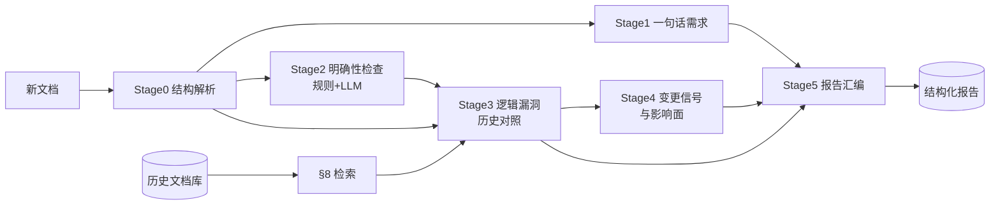
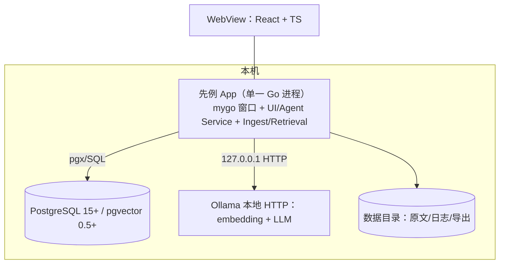

# 先例（Prior）· 产品需求文档

| 项 | 值 |
|---|---|
| 轮次 | 第 5 轮 / 共 5 轮 |
| 版本 | v0.5 |
| 日期 | 2026-10-15 |
| 状态 | 待评审（本轮后出定稿） |
| 聚焦 | 可执行收口：验收标准、测试与评测门禁、里程碑与范围、风险登记册、决策记录 |

## 本轮变更说明

相对 v0.4（裁决 Q6、Q7）：

- §1~§26 内容不变（等义压缩呈现）。
- 新增 §27 验收标准：12 条 AC，每条可测（Given/When/Then + 量化阈值）。
- 新增 §28 测试与评测策略：单元/集成/黄金评测集（golden set）+ 质量门禁（裁决 Q7：prompts 入 git 版本化，变更必须过门禁）。
- 新增 §29 里程碑与范围：M0~M3 六周计划 + v2 候选清单。
- 新增 §30 风险登记册：7 项风险，定级/信号/对策。
- 新增 §31 决策记录：Q1~Q7 全部裁决汇总。
- 定稿说明：下一文件 `PRD-FINAL.md` 消除迭代痕迹，作为唯一权威文档。

## 1. 背景与问题

产品同学脑中携带大量未落笔的上下文（历史字段口径、曾经的兜底分支、"全部改为 X"的迁移影响），新文档按字面实现即产生纰漏；历史文档散落各地，同样的问题反复出现。先例把隐性历史上下文变成显性的、带证据的问题清单，在文档评审阶段拦截纰漏。
<!----> 
## 2. 产品定位

**先例（Prior）**：本地运行的个人桌面 Agent——历史需求文档建成向量知识库；新文档自动检索相关历史文档并交叉比对，输出四类发现：逻辑漏洞、不明确的细节、一句话需求、变更信号与影响面。核心价值：把"开发纰漏"前移到"文档评审"。

## 3. 目标与非目标

**目标（v1）**：G1 批量导入历史文档、可靠去重、可搜索；G2 新文档自动完成"解析→检索→交叉分析→带证据报告"；G3 报告覆盖四类发现；G4 全流程本地运行，数据不出本机。

**非目标（v1）**：扫描件 OCR；自动改写文档；团队协作/在线部署/账号权限；需求生命周期管理（Jira 追踪）；代码/接口文档生成。

## 4. 用户角色

| 角色 | 核心诉求 |
|---|---|
| 主要：产品经理 | 发文前自查漏洞与不明确点，评审会上被证据直面质疑 |
| 次要：开发负责人 | 变更影响面 + 边界口径清单，减少返工 |
| 次要：测试 | 从一句话需求派生验收点 |

## 5. 核心场景

**C1 建库**：拖入约 50 篇历史 PRD → 解析/切块/embedding/入库 → 逐篇状态与统计 → 重复提示。
**C2 分析**：拖入新文档 → 选范围（全库/产品线）→ 开始 → 阶段进度流 → 通知 → 直达报告。
**C3 消费反馈**：报告顶部变更信号（"之前的逻辑全部不要了，全部改为 X"）与影响清单；其下逻辑漏洞（证据对照）与不明确项（给产品的问题）；一句话需求勾选出评审清单；逐条确认/误报 → 导出 Markdown 发群。

## 6. 功能清单（编号功能点）

**F1 文档库**：导入（文件/文件夹/zip；md/docx/pdf/txt/html；队列+进度）｜解析切块（字数/分块数/质量标记）｜去重（checksum；>0.95 弹窗）｜元数据编辑｜浏览搜索｜删除（级联 chunks，旧 finding 标"源已删除"）。
**F2 检索**：查询生成（≤30）｜混合召回（向量 topK=50 + 关键词，RRF k=60 → topM=200）｜LLM 重排（≥0.5）｜定位 top 8 文档 + 相关章节。
**F3 分析 Agent**：F3.1 一句话需求｜F3.2 明确性检查（规则六类+LLM 五类，必带 question）｜F3.3 逻辑漏洞（C1 S1 / C2 S2 / C3，必带历史证据）｜F3.4 变更信号（正则+LLM，五维影响清单）｜F3.5 运行控制（进度/取消/重跑/降级）。
**F4 报告**：概览+Tab+筛选+搜索｜证据对照+跳转｜反馈（四态+备注，误报入评测池）｜导出 MD/JSON｜"给产品的 N 问"一键复制。
**F5 设置**：Ollama（地址/模型/拉取命令）｜LLM 参数｜PG 自检｜索引重建｜数据目录与清空。
**F6 桌面外壳**：窗口/菜单/最近文档｜拖拽｜通知｜首启引导向导。

## 7. 分析引擎规格

### 7.1 发现（finding）统一结构（契约）

```json
{
  "id": "F-20261015-0031", "run_id": 12,
  "type": "logic_gap | ambiguity | one_liner | change_signal",
  "subtype": "conflict | coverage_gap | internal_conflict | quantified_ambiguity | undefined_reference | state_gap | permission_conflict | data_caliber",
  "severity": "S0 | S1 | S2 | S3", "confidence": 0.0,
  "title": "≤40 字结论句", "detail": "问题解释",
  "new_doc_span": { "quote": "…", "heading_path": ["3.2 会员积分"], "offset": 1234 },
  "evidence": [ { "doc_id": 7, "chunk_id": 88, "doc_title": "…", "heading_path": ["积分扣减"], "quote": "…" } ],
  "question": "建议向产品提出的澄清问题（ambiguity/change_signal 必填）",
  "suggested_fix": "…（可选）", "impact": "影响面描述（change_signal 必填）",
  "status": "open | confirmed | dismissed | needs_doc | deferred", "reviewer_note": ""
}
```

硬约束：所有 finding 带 `new_doc_span`；`logic_gap`/`change_signal` 必带非空 `evidence`；`confidence<0.5` 降级 S3。

### 7.2 严重度

S0 阻塞（如"全部作废改用 X"无存量迁移说明）｜S1 严重（明显冲突/关键口径缺失）｜S2 一般（边界细节待确认）｜S3 提示（表述/命名）。

### 7.3 五阶段流水线



S0 结构解析（doc_profile + glossary）→ S1 一句话需求（四元组+原文映射）→ S2 明确性（规则六类：占位符/空引用/模糊量词/分支缺失/枚举不全/被动无主；LLM 五类：歧义/隐含假设/边界/口径/兼容；必带 question）→ S3 逻辑漏洞（C1 冲突 S1 / C2 覆盖缺口 S2 / C3 文档内不一致；必带证据）→ S4 变更信号（正则粗筛+LLM 确认；五维影响清单：存量数据/接口兼容/灰度回滚/下游通知/受影响旧需求定位；默认 S0/S1）→ S5 汇编（空结果也出"未发现"报告）。

### 7.4 运行控制

分阶段进度事件；单阶段失败降级保留已产结果；可取消；可分阶段重跑；重复发起互不覆盖。

## 8. 检索规格

查询生成（≤30）→ 混合召回（向量 topK=50 + 关键词，RRF k=60 → topM=200）→ LLM 重排（规则级相关性 ≥0.5）→ 聚合（分 = max + 0.1×Σ其余，top 8 文档 + 相关章节）→ 上下文预算每文档 ≤4000 tokens，优先保留情态词段落。附章节×文档相关度矩阵。

## 9. 入库管线规格

md/docx/pdf/txt/html → 统一 IR → 规范化（去页眉页脚/表格转文本/全半角）→ 结构感知切块（300~600 tokens，界 200~800，带父级标题路径 + 上一块末段）→ Ollama 批量 embedding（重试 3 次）→ 入库；两级去重；产品线 LLM 推断候选。

## 10. 报告信息架构

概览 → 变更信号区（置顶）→ 逻辑漏洞区（证据对照）→ 不明确区（附问题）→ 一句话需求区（需求卡）→ 引用文档清单 → 操作（筛选/排序/反馈/导出）。

## 11. 系统架构



## 12. 数据模型（DDL）

与 v0.3/v0.4 一致：`documents`（checksum 唯一约束，status/superseded_by，product_line 索引）｜`chunks`（doc_id+chunk_index 唯一，heading_path text[]，tsv TSVECTOR，embedding vector(1024) HNSW 索引 m=16/ef_construction=64）｜`analysis_runs`（scope/models/stage_log JSONB，status 状态机）｜`findings`（§7.1 JSONB 契约，run_id+type+severity 索引，status 四态+备注）｜`settings`（KV JSONB）｜`eval_cases`/`eval_results`（黄金评测）。`tsv` 应用侧写入；换 embedding 维度须 migration + 重建索引。

## 13. 后端模块与 API

模块：config / store / ingest / embed / retrieval / agent / report / service。`mygo.Bind` 三服务：DocLibraryService（List/Import/ImportProgress(chan)/Get/UpdateMeta/Delete/ResolveDuplicate）｜AnalysisService（Create/Progress(chan)/Cancel/RetryStage/Report/Feedback/Export）｜SettingsService（Get/Update/CheckEnv）。ProgressEvent：stage/state/message/counts/elapsed_ms。

## 14. Ollama 与 LLM 接入

`GET /api/tags`、`POST /api/embed`、`POST /api/generate`（format:json）；串行推理 + 队列（LLM 2 / embed 4）；超时 embed 60s / LLM 300s，阶段重试 2 次；JSON 失败回传重试 ≤2 → 降级。模型：bge-m3(1024) / nomic-embed-text(768)；qwen2.5:14b-instruct / qwen3:14b。`LLMProvider{Embed,Generate}` 抽象，v1 仅 Ollama。

## 15. 前端规格（mygo）

webview + React + Vite + Bun；原生能力（对话框/拖拽/通知/菜单/最近文档）用 mygo desktop API。页面 `/docs`、`/analyze`、`/report/:runId`、`/history`、`/settings`；`mygo.Bind` 生成 TS client；进度走 channel；原文预览后端分页。

## 16. 目录结构

```
prd_viewer/
  prd/  backend/{cmd/app,internal/{config,store,ingest,embed,retrieval,agent,report,service},migrations,prompts}
  frontend/src/{pages,components,api}
  scripts/{setup-mac.sh,docker-compose.yml}
  docs/
```

## 17. 配置、错误处理与日志

config.yaml + settings 表覆盖；错误分层（中文 message + 机器码）；slog 落数据目录，默认不记原文。

## 18. 交互与边界（引用 v0.4）

逐页交互见 v0.4 §21；异常矩阵 B1~B16（环境缺失、扫描件、大文件、取消、模型更换、删除引用、导出失败、多导入队列等）；性能预算：导入 30 页 ≤90s；检索 ≤2s（重排 ≤60s）；10 页分析 ≤5min；30 页 ≤12min；报告渲染 ≤1s；App ≤300MB；PG ≤1GB。隐私：127.0.0.1 绑定、数据不出本机、日志脱敏、可清空全部数据。

## 19. 成功指标（维持）

召回相关率 ≥80%；真实问题占比 ≥70%；10 页分析 ≤5 分钟；连续 4 周内部试用。

## 20. 术语表

finding / 一句话需求 / 变更信号 / RRF / 规则级相关性 / IR / Provider 抽象 / channel（mygo typed IPC）／黄金评测集（golden set）。

## 21~26. （沿用 v0.4 §21~§26，无变化）

逐页交互规格、异常边界矩阵、性能预算、安全隐私、兼容性矩阵均以 v0.4 为准。

## 27. 验收标准（AC）

| # | 验收项 | Given / When / Then |
|---|---|---|
| AC1 | 导入 | Given 一份 30 页 md PRD，When 拖入文档库，Then ≤90s 完成，分块数符合 300~600 tokens 目标（且无 >800 token 块），UI 展示字数/分块数/状态 |
| AC2 | 去重 | Given 同一文件二次导入，Then 提示重复且库中仍为 1 条 |
| AC3 | 相似处理 | Given 两份 >0.95 相似文档，When 导入第二份，Then 弹窗三选项且均正确落库/关联 |
| AC4 | 检索质量 | Given 库内 20 篇 + 1 篇测试新文档，When 执行检索，Then top5 相关文档 3 人独立评判相关率 ≥80%（多数一致） |
| AC5 | 一句话需求 | Given 含 15 条需求的文档，When 分析完成，Then 输出 15 张卡，编号与原文映射零错位；四元组缺失被标注 |
| AC6 | 规则层检查 | Given 文档含 TBD 与"尽快"等词，When 分析，Then 规则层 100% 命中且 subtype 正确；LLM 层条目必带 question |
| AC7 | 逻辑漏洞 | Given 新文档与库中文档存在已知口径冲突，When 分析，Then 产出对应 logic_gap，evidence 指向正确 chunk |
| AC8 | 变更信号 | Given 文档含"之前的逻辑全部不要了，全部改为 X"，When 分析，Then 产出 S0/S1 change_signal；影响清单含旧需求定位 + 五维度检查，缺失维度列入 question |
| AC9 | 反馈 | Given 对 finding 标记误报，Then 状态更新、列表可见、样本入评测池 |
| AC10 | 导出 | Given 任意 run，When 导出，Then MD 含全部 finding 与证据引文；JSON 通过 schema 校验 |
| AC11 | 环境自检 | Given 错误 Ollama 地址，When 设置保存/CheckEnv，Then 明确报错与修复指引，不影响既有数据 |
| AC12 | 性能 | Given 10 页新文档，When 端到端分析，Then ≤5min 出报告；导入/检索/渲染满足 §18 预算 |
| AC13 | 打包 | Given 干净 macOS 13+，When 安装 .app 首启，Then 向导完成 PG/Ollama 检测；拖拽/通知/导出可用 |

## 28. 测试与评测策略

- **单元**：解析（md/docx/pdf fixture）、切块边界（200/800 界值）、checksum/相似去重、规则层模式库（六类各正反例）、RRF 融合。
- **集成**：测试容器 PG（pgvector）+ 真实 Ollama，跑通 1 篇黄金文档全链路（入库→检索→分析→报告→导出）。
- **黄金评测集（golden set）**：从历史库选 3 篇作为"伪新文档"，人工标注预期 findings（每篇 10~20 条，侧重 logic_gap 与 change_signal）；`eval_cases` 落库。
- **质量门禁（Q7 裁决）**：`backend/prompts/` 入 git 版本化；任何 prompt/模型/参数变更须跑 golden set：精确率 P ≥ 0.60 且召回不低于上一版本才允许合入；结果写 `eval_results`。
- **误报闭环**：用户 dismissed 样本周汇总，反哺规则与 prompt；不追求 100% 自动修复。
- **明确不测**：UI 像素级细节、第三方库内部行为、模型知识正确性本身。

## 29. 里程碑与范围

| 里程碑 | 周期 | 交付 | 出口标准 |
|---|---|---|---|
| M0 基建 | 1 周 | 仓库骨架、config/migration、Ollama client、mygo 空壳（五页+导航）、引导向导 | 干净机器按 scripts/setup-mac.sh 跑通环境检测 |
| M1 文档库 | 2 周 | 解析 md/docx/pdf、切块、embedding、去重、列表/详情/搜索、导入队列 | AC1~AC3 通过 |
| M2 引擎 | 2 周 | 检索管线、五阶段 agent、报告页、导出、反馈；用 20 篇真实文档调 prompt；golden set v1 | AC4~AC10 通过；golden P ≥ 0.60 |
| M3 收尾 | 1 周 | 边界矩阵落地、设置页、性能达标、.app/.dmg 打包、使用文档 | AC11~AC13 通过；内部 4 周试用启动 |

**v2 候选（明确不做进 v1）**：OCR；云端 Provider 开关（显式授权）；团队模式（后端独立部署 + 多端）；需求双向链接（库内文档互链）；benchmark 报告脚本。

## 30. 风险登记册

| # | 风险 | 等级 | 早期信号 | 对策 |
|---|---|---|---|---|
| R1 | 本地 14B 输出不稳定/幻觉 | 高 | golden P < 0.6 或 dismissed 率上升 | 强制证据引用 + confidence；规则层兜底（确定性检查不依赖 LLM）；人工审阅闭环；必要时上调模型档位 |
| R2 | 中文 embedding 效果不足 | 中 | AC4 相关率 < 80% | 换 bge-m3；混合召回补关键词；查询扩展（术语实体） |
| R3 | 大文档上下文超限 | 中 | Stage 超时/截断告警 | 章节级 MapReduce；每文档 4000 token 预算；情态词优先保留 |
| R4 | PG/Ollama 环境门槛 | 中 | 试用卡在安装 | setup 脚本 + docker-compose + 引导向导 + 自检 |
| R5 | prompt 变更无回归 | 高 | 质量悄悄劣化 | prompts 入 git + golden 门禁（§28） |
| R6 | PDF 解析质量差 | 中 | 解析质量评分低 | 质量评分阈值，低于阈值拒收并提示（B2） |
| R7 | 误报导致信任流失 | 中 | dismissed 率周环比上升 | 证据透明、severity 分级、可驳回、周报复盘反哺 |

## 31. 决策记录（Q1~Q7 裁决汇总）

| # | 问题 | 裁决 | 轮次 |
|---|---|---|---|
| Q1 | LLM 选型 | 本地 Ollama，默认 qwen2.5:14b-instruct 级；Provider 抽象预留云端（v2 显式授权） | v0.2 |
| Q2 | 检索策略 | 混合召回 + LLM 规则级重排（相似 ≠ 相关） | v0.2 |
| Q3 | 前端形态 | mygo web 前端（webview + React + TS）+ 原生 desktop API | v0.3 |
| Q4 | 存储 | PostgreSQL + pgvector，维度随模型（默认 1024），换模型重建索引 | v0.3 |
| Q5 | 边界清单 | B1~B16 异常矩阵 | v0.4 |
| Q6 | 验收/里程碑/风险 | §27 AC / §29 里程碑 / §30 风险册 | v0.5 |
| Q7 | prompt 治理 | prompts 入 git 版本化 + golden set 质量门禁 | v0.5 |
