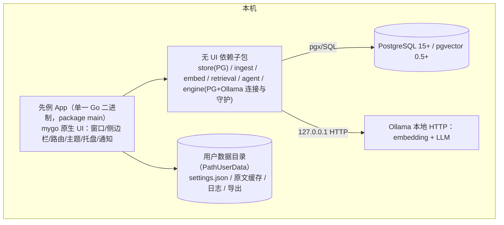

# 先例（Prior）· 产品需求文档

| 项 | 值 |
|---|---|
| 轮次 | 第 6 轮 / 调整轮 |
| 版本 | v0.6 |
| 日期 | 2026-10-15 |
| 状态 | 待评审（本轮后更新定稿） |
| 聚焦 | 参考 motrix-mygo 调整：前端形态翻转为 mygo 原生 UI，架构/目录/配置/构建/测试全面对齐参考项目 |

## 本轮变更说明（参考项目调研结论）

**参考实现**：[missuo/motrix-mygo](https://github.com/missuo/motrix-mygo)——Motrix 的界面用 Go 重写于 MyGo **原生 UI**（`ui` 包，GPU 绘制，无 Electron、无 webview），驱动 aria2 引擎。调研得到的关键模式：

| 参考项目模式 | 具体做法 |
|---|---|
| 单一 Go module | 无前端工具链；`go tool mygo dev`（热重载）/ `go tool mygo build`（打包）；Go 1.27+，无 cgo |
| 扁平 package main | 根目录按页拆分文件（`main.go`/`app.go`/`downloads.go`/`settings_view.go`/`theme.go`/`widgets.go`/`i18n.go`…）；`engine/` 为**不依赖 UI** 的子包 |
| view = state 纯函数 | `app` 结构体持有全部状态；`a.view(c *ui.Context)` 每帧从状态重绘；禁止跨 goroutine 直接触状态，一律经 `a.update(fn)` → `win.Update` 主线程跳转 |
| 路由与导航 | `ui.NewRouter("/downloads")` + `r.Match("/path")`/`r.Param`；侧边栏 navItem + 徽标；`router.Push/Replace` |
| 列表与筛选 | `ui.ListState` 虚拟列表 + 手绘列（列宽/对齐/显隐可配）；状态 filter chips；`ui.SearchField` + `Cmd+F`；右键/`⋯` 菜单（`ui.Menu`）；右侧 details/inspector 面板可开关 |
| 表单与设置 | `ui.TextInput/Switch/Select/NumberInput/Segmented/Button/PrimaryButton`；`ui.Grid` 分区卡片；草稿-保存模式（`Cmd+S`）与即时生效分区并存；`ui.Scroll` |
| 主题 | `mygo.Theme.SetSource(Light/Dark/System)`；自定义 palette 派生自 `c.Theme()`；强调色可换 |
| 配置 | `settings.json` 存 `mygo.App.Path(PathUserData)` 下的应用自有目录；分层设置、规范默认值 |
| 窗口 | 隐藏标题栏自绘 chrome（`TitleBarStyle: TitleBarHidden` + `TrafficLightPosition` + `TitleBarHeight`）；`StateKey` 记忆窗口状态；`AutoHideMenuBar`；macOS 应用菜单用 `mygo.NewMenu` + Role |
| 桌面集成 | 单实例锁；托盘/菜单栏驻留（关闭窗口不清退，运行中任务继续）；`OnBeforeQuit` 有任务时确认；系统通知 + 应用内通知页（未读徽标）；`mygo.Dialog.Message` 确认框；`mygo.Shell` 打开/删除文件 |
| i18n | 全部文案过 `T()`；`i18n.go` 维护 en / zh-Hans 双语；`mygo.App.Locale()` 跟随系统 |
| 更新 | updater 插件（原生更新窗口，Sparkle 式）；`mygo.json` 的 `updates.publicKey` + GitHub 仓库 |
| 测试 | 视图逻辑无窗口可测（`win == nil` 时 `update` 直接执行）；`TestLive` 真实运行并重写 `docs/screenshots/`；`go vet` + `gofmt` 干净才提交 |

**决策翻转（记 Q3'，取代 v0.3 的 Q3）**：

- v0.3 曾裁决 webview + React + TS client，理由是"重度文本渲染、筛选看板"。
- 用户指定参考 motrix-mygo → 形态翻转为 **mygo 原生 UI（纯 Go，无 webview/Electron/JS）**。
- 修正理由：mygo `ui` 包提供富文本、表格、虚拟列表、输入法、SVG 图标、动画、无障碍支持；motrix-mygo 已证明"列表+筛选+详情面板+设置分区+通知+托盘"的复杂桌面工具可完整原生落地。收益：即时启动、低内存、无 JS 工具链（删 Bun/React/Vite）、单二进制、跨平台零 webview 运行时依赖（Linux 只需 GTK3，Windows 无需 WebView2 Runtime）。

**影响面（本章重写，其余不变）**：目录结构（删 `frontend/`，改扁平 package main + 无 UI 子包）、配置（`config.yaml` + `settings` 表 → `settings.json`）、IPC（`mygo.Bind` + channel → 进程内直接调用 + `win.Update` 事件）、交互规格（逐页重写为原生控件清单）、构建与测试（`go tool mygo`、视图无窗口测试、live test 截图）、兼容性（macOS 12+ / Win10+ / Linux GTK3）、DDL（删 `settings` 表，其余不变）。

**不变**：四类发现契约、五阶段引擎、混合检索、入库管线、pgvector DDL（除 settings 表）、AC 主体、性能预算、隐私红线、风险册、成功指标。

---

## 1. 背景与问题

产品同学脑中携带大量未落笔的上下文（历史字段口径、曾经的兜底分支、"全部改为 X"的迁移影响），新文档按字面实现即产生纰漏；历史文档散落各地，同样的问题反复出现。先例把隐性历史上下文变成显性的、带证据的问题清单，在文档评审阶段拦截纰漏。

## 2. 产品定位

**先例（Prior）**：本地运行的个人桌面 Agent——历史需求文档建成向量知识库；新文档自动检索相关历史文档并交叉比对，输出四类发现：逻辑漏洞、不明确的细节、一句话需求、变更信号与影响面。形态：**mygo 原生 UI 桌面 App（单 Go 二进制，无 webview）**，参考 [motrix-mygo](https://github.com/missuo/motrix-mygo) 的架构组织方式。

## 3. 目标与非目标

**目标（v1）**：G1 批量导入历史文档、可靠去重、可搜索；G2 新文档自动完成"解析→检索→交叉分析→带证据报告"；G3 报告覆盖四类发现；G4 全流程本地运行，数据不出本机。

**非目标（v1）**：扫描件 OCR；自动改写文档；团队协作/在线部署/账号权限；需求生命周期管理（Jira 追踪）；代码/接口文档生成；任何 web 前端/webview 形态。

## 4. 用户与核心场景

| 角色 | 核心诉求 |
|---|---|
| 主要：产品经理 | 发文前自查漏洞与不明确点，评审会上被证据直面质疑 |
| 次要：开发负责人 | 变更影响面 + 边界口径清单，减少返工 |
| 次要：测试 | 从一句话需求派生验收点 |

**C1 建库**：拖入约 50 篇历史 PRD → 解析/切块/embedding/入库 → 逐篇状态与统计 → 重复提示。
**C2 分析**：拖入新文档 → 选范围（全库/产品线）→ 开始 → 阶段进度流 → 系统通知 → 直达报告。
**C3 消费反馈**：报告置顶变更信号（"之前的逻辑全部不要了，全部改为 X"）与影响清单；其下逻辑漏洞（证据对照）与不明确项（给产品的问题）；一句话需求勾选出评审清单；逐条确认/误报 → 导出 Markdown 发群。

## 5. 总体架构（对齐 motrix-mygo）



架构规则（继承参考项目）：

- **view = state 纯函数**：`app` 结构体持有全部 UI 状态；`a.view(c *ui.Context)` 每帧从状态重绘；引擎 goroutine 只经 `a.update(fn)`（内部 `win.Update`）触达状态；测试中 `win == nil` 时 `update` 同步执行，视图逻辑无窗口可测。
- **UI 与内核分离**：`store/ingest/embed/retrieval/agent/engine` 子包禁止 import `ui`；页面文件（`library.go` 等）只做渲染与状态编排。
- **错误即 toast**：内核调用返回 error，统一 `a.try(err)` 弹 toast 并刷新（对齐 `app.try`）。
- **单实例 + 托盘驻留**：关闭窗口隐藏到托盘，分析继续；`OnBeforeQuit` 在分析/导入运行时确认。
- **数据目录**：`mygo.App.SetPath(PathUserData, …/Prior)`，应用自有目录，与参考项目"app 数据不与他人混居"同一原则。

## 6. 目录结构（对齐参考项目）

```
prd_viewer/
  prd/                      # 需求文档（本目录）
  mygo.json                 # name/identifier/version/out/updates(publicKey+GitHub)
  main.go                   # 生命周期：单实例锁/路径/菜单/托盘/窗口/退出确认/updater 插件
  app.go                    # app 状态结构体 + view + router + update(fn) + try(err)
  library.go                # /library 文档库页（列表/筛选/导入/详情面板）
  import.go                 # 导入作业与进度
  analyze.go                # /analyze 分析台页（配置/进度 stepper/日志/取消）
  report.go                 # /report/{runID} 报告页（findings 列表/证据对照/反馈/导出）
  history.go                # /history 历史分析页
  notifications.go          # 应用内通知页 + 系统通知
  settings.go               # settings.json 模型/环境自检/索引重建
  settings_view.go          # /settings 分区卡片 + 草稿保存
  theme.go                  # palette（light/dark/system + 强调色）
  widgets.go                # 共享控件：finding 卡片/严重度徽标/证据双栏/空态/进度行
  i18n.go                   # T()；en / zh-Hans 双语目录
  engine/                   # PG+Ollama 连接、健康检查、migration 运行（不 import ui）
  store/                    # pgx 数据访问 + migrations/*.sql
  ingest/                   # 解析/规范化/切块/去重
  embed/                    # Ollama embedding client
  retrieval/                # 查询生成/混合召回/重排/聚合
  agent/                    # 五阶段流水线 + prompts/
  resources/                # 图标
  scripts/                  # setup-mac.sh、docker-compose.yml、make-icon
  docs/                     # 使用说明 + screenshots/（live test 生成）
```

## 7. 功能需求（F1~F6，规则不变，实现方式对齐原生 UI）

### F1 文档库 `/library`

- 导入：按钮（文件对话框/文件夹/zip）+ 窗口拖拽；队列串行，行内进度（解析→切块→embedding→入库）。
- 列表：虚拟列表（`ui.ListState`）+ 列（标题/格式/产品线/分块数/状态/导入时间），列宽与显隐可配；状态 filter chips + 关键词搜索（`Cmd+F`）。
- 详情面板（inspector，可 `Cmd+I` 开关）：元数据编辑 + 分块列表（heading_path 面包屑 + token 数，点击定位原文）+ 原文预览。
- 去重：checksum 跳过；>0.95 弹 `mygo.Dialog.Message` 选择（仍入库/作为新版本/取消）。
- 删除：确认对话框；级联 chunks；旧 finding 证据标"源已删除"。

### F2 检索（内核，无 UI）

查询生成（≤30）→ 混合召回（向量 topK=50 + 关键词，RRF k=60 → topM=200）→ LLM 重排（规则级相关性 ≥0.5）→ 聚合（分 = max + 0.1×Σ其余，top 8 文档 + 相关章节）→ 每文档 ≤4000 tokens 预算，情态词段落优先。附章节×文档相关度矩阵（报告页迷你热力图）。

### F3 分析 Agent（内核，无 UI）

五阶段流水线（S0 结构解析 → S1 一句话需求 → S2 明确性检查 → S3 逻辑漏洞 → S4 变更信号 → S5 报告汇编）与四类发现契约**完全不变**（见 §8）；goroutine 执行，阶段事件经 `a.update` 推进 UI。

### F4 报告 `/report/{runID}`

- 概览：四类计数 + 严重度分布 + run 元数据 + 章节×文档迷你热力图。
- findings 虚拟列表：类型 Tab（变更信号置顶）｜逻辑漏洞｜不明确｜一句话需求；Tab 内严重度筛选 + 搜索 + 排序。
- finding 卡片：类型角标 + 严重度色点（palette tone：red/amber/blue/slate）+ title + detail + 置信度；证据双栏（新文档引文命中词高亮 ↔ 历史文档引文 + 文档名 + heading_path + 跳转按钮）；question 一键复制（`mygo.Clipboard`）；操作：确认/误报/待补充文档/搁置 + 备注。
- 一句话需求区：需求卡表格，可勾选「生成评审清单」。
- 导出：`ui` 保存对话框写 Markdown / JSON。
- 空态：`emptyState` 控件显示"未发现 X 类问题"+ 检索覆盖说明。

### F5 设置 `/settings`

分区卡片（`ui.Grid`）：**环境**（PG DSN/自检、Ollama 地址与模型/`ollama pull` 命令展示、索引重建任务、数据目录）｜**分析**（模型/温度/num_ctx/超时、默认范围、完成通知开关）｜**外观**（主题 system/light/dark `ui.Segmented`、语言、强调色）｜**数据**（目录迁移提示、清空全部数据，需输入 DELETE 二次确认）｜**关于**（版本、检查更新、开源地址）。
草稿-保存模式用于连接/模型等重启生效项；外观与通知开关即时生效（对齐参考项目 Save/Discard 底栏 + `Cmd+S`）。

### F6 桌面外壳（原生 UI）

- 窗口：默认 1024×680，最小 960×620；隐藏标题栏自绘 chrome（右侧避让窗口控制按钮，对齐 `trailingInset` 规则）；`StateKey` 记忆；`AutoHideMenuBar`；侧边栏可折叠（动画）带未读徽标。
- 菜单：macOS 应用菜单（About/Check for Updates…/角色菜单）+ 标准 File/Edit/View/Window。
- 托盘：关闭窗口驻留托盘，菜单"显示/退出"；分析中退出前确认（`OnBeforeQuit` + `mygo.Dialog.Message`）。
- 通知：分析完成/失败系统通知 + 应用内通知页（未读徽标，对齐 motrix notifications 模式）。
- i18n：en / zh-Hans 双语，`T()` 全覆盖；`mygo.App.Locale()` 默认跟随系统。
- 更新：updater 插件原生更新窗口；每日检查；菜单项 + 关于页开关。

## 8. 引擎规格（不变，摘要）

- finding 契约（§7.1 v1.0 全文保留）：type/subtype/severity/confidence/new_doc_span/evidence/question/suggested_fix/impact/status/reviewer_note；硬约束（必带 span；logic_gap/change_signal 必带 evidence；confidence<0.5 降 S3）不变。
- 严重度 S0~S3 定义不变。
- S0~S5 五阶段输入输出不变；S2 规则六类（占位符/空引用/模糊量词/分支缺失/枚举不全/被动无主）+ LLM 五类不变；S3 C1/C2/C3 不变；S4 五维影响清单不变；S5 空结果也出报告不变。
- 运行控制：阶段进度事件、取消（context）、分阶段重跑、失败降级不变——事件经 `a.update` 送到 UI。
- 检索/入库管线规则不变（300~600 tokens 切块、两级去重、情态词优先等）。

## 9. 数据模型（DDL，删除 settings 表）

与 v1.0 一致：`documents`（checksum 唯一 = 一级去重）｜`chunks`（doc_id+chunk_index 唯一，heading_path text[]，tsv，embedding vector(1024) HNSW m=16/ef=64）｜`analysis_runs`（scope/models/stage_log JSONB）｜`findings`（§8 JSONB 契约）｜`eval_cases`/`eval_results`（黄金评测）。
**变更**：删除 `settings` 表——应用设置改存 `settings.json`（见 §10）；换 embedding 维度仍须 migration + 重建索引。

## 10. 配置与外部依赖（对齐参考项目）

- **settings.json**：存 `mygo.App.Path(PathUserData)` 下 `Prior/settings.json`；schema 版本化；分层：连接（PG DSN、Ollama base_url）、模型（embed/llm/温度/num_ctx/超时）、外观（主题/语言/强调色）、UI（侧边栏折叠、列表列显隐、inspector 开关）、数据目录、通知开关。保存即写盘；与参考项目一致地"用户文件可手改，启动时规范化"。
- **PostgreSQL**：15/16/17 + pgvector ≥0.5；`scripts/docker-compose.yml` 或 Homebrew；启动时 `engine` 子包跑 migration（`store/migrations/*.sql` 编号执行）+ 健康检查（失败重试与明确指引）。
- **Ollama**：≥0.3；`GET /api/tags`、`POST /api/embed`、`POST /api/generate`（format:json）；串行推理 + 队列（LLM 2 / embed 4）；超时 embed 60s / LLM 300s；JSON 失败回传重试 ≤2 次再降级。模型：bge-m3(1024)/nomic-embed-text(768)；qwen2.5:14b-instruct/qwen3:14b。`LLMProvider` 抽象 v1 仅 Ollama。
- **构建**：Go 1.27+，无 cgo，无 Bun；`go tool mygo dev` / `go tool mygo build`；`mygo doctor` 自检开发机。
- **mygo.json**：`{"name":"Prior","identifier":"app.prior.mygo","version":"…","out":"build","updates":{"publicKey":"…","github":"<owner>/<repo>"}}`；私钥只进 GitHub secrets。

## 11. 交互规格（逐页，原生控件清单）

**`/library`**：页头（标题+统计徽标+`⋯`菜单：全部暂停导入/重试失败/清理已完成）+ 行内搜索；左列表右 inspector；拖拽导入全窗高亮；导入作业底部进度条。
**`/analyze`**：拖拽区多文件入队；配置卡（产品线 chips/模型/通知开关）；「开始分析」→ stepper（解析→检索→S1~S5）+ 当前阶段实时日志行（"检索命中 6 篇，最强相关：《积分规则 v2.1》"/"S3 产出 12 条"）+ 耗时 + 取消；失败阶段红点 + 「重跑该阶段/全部」。
**`/report/{runID}`**：见 §7 F4；快捷键 `Cmd+F` 搜索、`Cmd+I` 开关 inspector、`Cmd+S` 导出。
**`/history`**：run 列表（状态/耗时/四类计数）+ 打开/重跑/删除；部分结果标记。
**`/settings`**：见 §7 F5；`Cmd+S` 保存草稿；未保存底栏（对齐参考项目）。
**通知页**：`/notifications` 列表 + 未读徽标 + 系统通知开关。

## 12. 异常与边界矩阵（B1~B16，不变）

环境缺失（Ollama/PG 未启动、模型缺失、缺 pgvector）→ 首启向导与自检给命令；扫描件 PDF 拒绝；checksum/0.95 两级去重；大文件后台队列 + 拆分建议；分析取消保留部分结果；LLM 超时阶段重试 2 次再降级；换 embedding 模型触发重建索引（期间停新分析）；删除被引用文档证据标"源已删除"；导出失败明确报错；多导入队列串行；设置错误即时校验不影响既有数据。

## 13. 性能与资源预算（维持，内存项更优）

导入 30 页 ≤90s；检索 ≤2s（重排 200 chunk ≤60s）；10 页分析 ≤5min；30 页 ≤12min；报告渲染（≤100 findings）≤1s（虚拟列表）；**App 常驻内存 ≤300MB（原生 UI 无 webview 宿主，预算更易达成）**；PG ≤1GB；每 1000 chunk ≈4MB 向量。

## 14. 安全与隐私（不变）

仅绑 127.0.0.1；数据不出本机；日志脱敏不记原文；清空全部数据需输入 DELETE 二次确认；无远端崩溃上报。

## 15. 质量保障（调整测试基线）

- 单元：解析 fixture、切块界值、去重、规则层模式库、RRF、**视图逻辑无窗口测试**（`win == nil`，对齐参考项目）。
- 集成：容器 PG + 真实 Ollama 全链路。
- 黄金评测集：3 篇人工标注；门禁 P ≥ 0.60 且召回不降；prompts 入 git 版本化。
- 视觉回归：`TestLive`（`PRIOR_LIVE=1`）真实跑一遍并重写 `docs/screenshots/`；默认窗口 1024×680 与最小 960×620 下无裁切/省略号（对齐参考项目的规则）。
- 提交前 `go vet ./... && gofmt -l .` 干净；跨平台 `GOOS=windows/linux go vet`。
- 误报闭环：dismissed 周汇总反哺。
- 明确不测：第三方库内部行为、模型知识正确性。

## 16. 验收标准（AC，主体不变，两条适配原生形态）

| # | 验收项 | Given / When / Then |
|---|---|---|
| AC1 | 导入 | 30 页 md 拖入，≤90s 完成，分块 300~600 tokens（无 >800），UI 展示统计 |
| AC2 | 去重 | 同文件二次导入提示重复，库中仍 1 条 |
| AC3 | 相似处理 | >0.95 弹窗三选项均正确 |
| AC4 | 检索质量 | top5 相关文档 3 人评判相关率 ≥80% |
| AC5 | 一句话需求 | 15 条需求 → 15 张卡，映射零错位，缺失项标注 |
| AC6 | 规则层 | TBD/"尽快" 100% 命中且 subtype 正确；LLM 条目带 question |
| AC7 | 逻辑漏洞 | 已知口径冲突产出 logic_gap，evidence 指向正确 chunk |
| AC8 | 变更信号 | "之前的逻辑全部不要了，全部改为 X" → S0/S1 change_signal + 五维影响清单 |
| AC9 | 反馈 | 误报标记生效并入评测池 |
| AC10 | 导出 | MD 含全部 finding 与引文；JSON 过 schema 校验 |
| AC11 | 环境自检 | 错误 Ollama 地址明确报错，不影响既有数据 |
| AC12 | 性能 | 10 页端到端 ≤5min；满足 §13 预算 |
| AC13（改） | 桌面原生形态 | 干净机 `go tool mygo build` 产出 .app/.dmg 与 Windows installer；首启向导完成环境检测；拖拽/通知/托盘/导出可用；窗口无 webview 进程 |
| AC14（增） | 双语 | 切换 en/zh-Hans，全部可见文案随语言变化，无遗漏硬编码 |

## 17. 里程碑与范围（M0~M3，交付物调整）

| 里程碑 | 周期 | 交付 | 出口 |
|---|---|---|---|
| M0 基建 | 1 周 | 仓库骨架（mygo.json/扁平 main 包）、engine 子包（PG 连接+migration+Ollama client）、mygo 空壳（侧边栏+路由+主题）、首启向导 | 干净机按 scripts/setup-mac.sh 跑通环境检测；`go tool mygo dev` 起窗 |
| M1 文档库 | 2 周 | 解析 md/docx/pdf、切块、embedding、去重、library 页（列表/筛选/inspector/拖拽/导入队列） | AC1~AC3 |
| M2 引擎 | 2 周 | 检索管线、五阶段 agent、analyze 进度流、report 页（证据双栏/反馈/导出）、history、notifications；20 篇真实文档调 prompt；golden set v1 | AC4~AC10 |
| M3 收尾 | 1 周 | settings 分区、边界矩阵、性能、i18n、.app/.dmg/Windows installer 打包、updater、使用文档 | AC11~AC14；连续 4 周内部试用 |

**v2 候选（不进 v1）**：OCR；云端 Provider 开关；团队模式；库内文档双向链接；benchmark 脚本。

## 18. 风险登记册（R1~R7 不变，新增一条）

R1 本地模型幻觉（证据强制+规则兜底+golden 门禁）；R2 中文 embedding（bge-m3+混合召回）；R3 大文档上下文（MapReduce+预算截断）；R4 环境门槛（脚本+docker+向导）；R5 prompt 无回归（git+门禁）；R6 PDF 质量（阈值拒收）；R7 误报信任（证据透明+可驳回）。
**R8（增）原生 UI 富文本渲染受限**：证据双栏/高亮/长引文若超出 `ui` 控件能力 → 早期在 M2 用 TestLive 截图验证渲染质量；兜底方案：引文用可选中的等宽文本块 + 章节面包屑定位，复杂高亮降级为关键词加粗；仍不足则该页回退为系统默认浏览器打开本地 HTML 报告（保底导出物）。

## 19. 成功指标（不变）

召回相关率 ≥80%；真实问题占比 ≥70%；10 页分析 ≤5 分钟；连续 4 周内部试用。

## 20. 术语表（增补）

finding / 一句话需求 / 变更信号 / 规则级相关性 / RRF / IR / Provider 抽象 / golden set 不变；新增：**原生 UI（mygo `ui` 包，GPU 绘制，无 webview）**、**inspector（右侧详情面板）**、**draft-save（设置草稿-保存模式）**、**stepper（分析阶段进度条）**。

## 21. 决策记录（更新）

| # | 问题 | 裁决 | 轮次 |
|---|---|---|---|
| Q1/Q2 | LLM、检索 | 本地 Ollama；混合召回 + LLM 重排 | 第 2 轮 |
| **Q3（改）** | **前端形态** | **mygo 原生 UI（纯 Go，无 webview/Electron/JS），参考 motrix-mygo；废弃 v0.3 的 webview+React 裁决** | **第 6 轮** |
| Q4 | 存储 | PG+pgvector，维度随模型 | 第 3 轮 |
| Q5 | 边界 | B1~B16 | 第 4 轮 |
| Q6 | 验收/里程碑/风险 | AC/里程碑/风险册 | 第 5 轮 |
| Q7 | prompt 治理 | git 版本化 + golden 门禁 | 第 5 轮 |
| Q8（增） | 设置存储 | settings.json（用户数据目录），删除 settings 表 | 第 6 轮 |

## 22. 目录结构与版本历史

目录见 §6。版本：v0.1~v0.5（第 1~5 轮）→ v0.6（第 6 轮：形态调整）→ v1.1 定稿（见 PRD-FINAL.md）。
