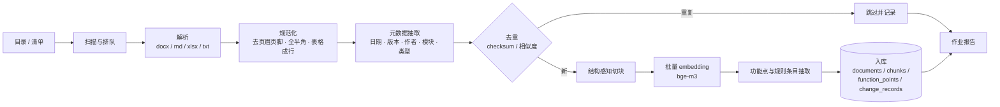
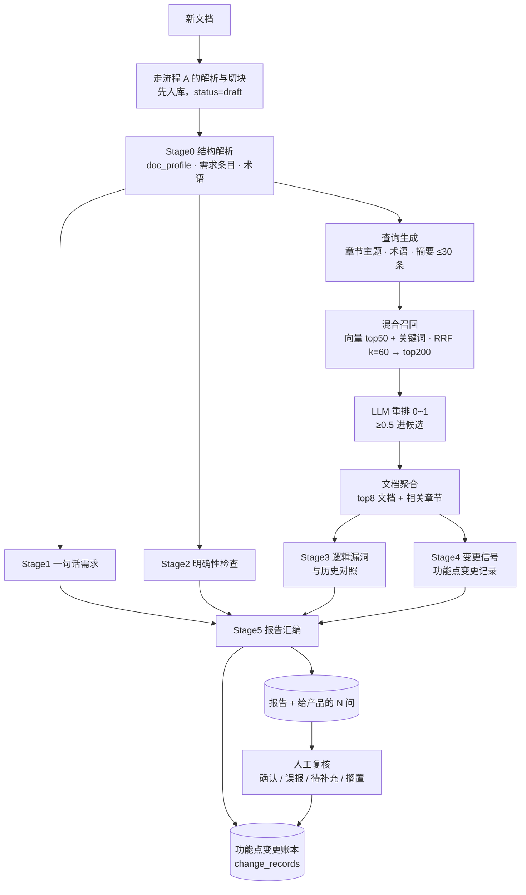

# 第 7 轮 · 业务流程定稿：两套入库流程与文档评审

> 版本 v7.0 ｜ 状态：实施中 ｜ 上游：[PRD-FINAL.md](./PRD-FINAL.md)（v1.1）· [ui-design.md](./ui-design.md)
> 本文是**业务流程**的唯一权威说明，覆盖：文档直接入库（存量）、文档分析入库（新文档 + 评审）、元数据与日期抽取、功能点变更账本、数据模型增量、验收标准。
> 与 PRD-FINAL 冲突处以本文为准；本文未涉及的部分仍以 PRD-FINAL 为准。

---

## 1. 背景：为什么是两套流程

团队从 2023 年至今积累了 **173 份**产品文档（152 docx / 17 markdown / 3 xlsx / 1 csv，正文 77.3 万字，切块 2027 块，时间跨度 2023-08 至 2026-10）。这些文档有两种命运：

| | 存量文档（旧） | 新文档（当下） |
|---|---|---|
| 有评审机会吗 | 没有：需求已上线或已作废，评审没有意义 | 有：正是要评审的对象 |
| 我们要什么 | 把它的**知识**收进来，供后续检索与对照 | 对照历史**找出变更与问题**，让产品在开发前改掉 |
| 产物 | 文档 + 结构化元数据 + 向量 + **功能点与规则条目** | 评审发现（finding）+ **功能点变更记录** + 报告 |
| 流程 | **流程 A：文档直接入库** | **流程 B：文档分析入库** |

一句话：**A 建账，B 用账并记账**。A 把历史文档变成可检索的规则与功能点；B 拿新文档去对账，产出变更记录与评审问题，并把新文档与它的变更记录重新入库。

---

## 2. 流程 A：文档直接入库（存量建档）

### 2.1 流程



### 2.2 触发与范围

- **入口**：文档库页「导入目录」（选择文件夹）、拖拽文件/文件夹到窗口、CLI `prior-cli ingest <目录>`。
- **扫描**：递归目录，识别 `docx / xlsx / md / markdown / txt / csv`；其余跳过并在报告里列出。
- **清单增强**：目录下的 `下载清单.csv`（列：需求名称 / 文档标题 / 链接 / 类型 / 状态 / 本地文件名）按文件名匹配，补齐**模块名**、飞书链接与导出状态；匹配到即以清单为准（`date_source=manifest` 时同样以清单为准）。
- **并发**：解析与切块可并行（读盘 + CPU），embedding 串行批量（Ollama 侧并发会拖慢整体）。

### 2.3 元数据抽取规则（含日期）

文档没有统一模板，元数据按**可信度排序**取最优值，并把来源记录下来供界面与人工复核：

| 字段 | 来源优先级（高 → 低） | 说明 |
|---|---|---|
| **日期** | 清单 > 正文「创建日期 / 撰写日期 / 文档日期」字段 > 文件名完整日期 > 变更日志最早时间 > 正文任意日期（最早，排除 01-01 之类的模板示例）> 文件名「MMDD」（年份取文件年份，标记推定）> **未知**（展示文件时间并标记「日期未知」） | 语料实测：字段 79 / 文件名 48 / 正文 20 / 变更日志 3 / MMDD 1 / 未知 22（共 173） |
| 标题 | 文件名（去日期前缀、去下载后缀）→ 首个一级标题 | 保留文件名中的日期与版本，便于人工核对 |
| 版本 | 文件名 `V1.0.0` / `v1.0` / `1.0.0` | 无则空 |
| 作者 | 正文「审核人 / 撰写人 / 作者 / 负责人」字段（段落或信息表单元格） | |
| 模块 | 清单「需求名称」→ 文件名 `【…】` | 用于按模块检索与变更账本分组 |
| 文档类型 | `requirement / issue_list / suggestion / guide / table / unknown` | 由标题关键词与结构推断 |
| 状态 | 清单「状态」（已下载 / 失败）；正文标注「已上线 / 已作废」时覆盖 | |

**日期未知的 22 份**（13%）不猜测：入库时 `date_confidence=0.2`，界面在日期列显示「日期未知」并在详情面板给出文件时间与提示；排序时排在同日期的最后。

### 2.4 解析与规范化

- **docx**：读 `word/document.xml`，按 `pStyle` 识别标题层级（导出器把层级写成 `1/2/3` 或 `Heading1`）；表格按行转「列 | 列」；图片与媒体不解码（语料含 1.1GB 图片，正文只有 77 万字）。
- **xlsx**：`sharedStrings.xml` + 各 sheet 视为表，sheet 名作标题（属性字段表、评估体系、试题模板属于此类）。
- **markdown**：标题 / 列表 / 表格 / 代码块；图片链接丢弃，链接保留文字。
- **txt / csv**：按「一、」「1.2」识别标题，其余为段落。
- **失败与异常**：非 zip 的 `.docx`（下载失败留下的错误文本）直接判失败并给出其中内容摘要；正文 < 100 字标记「文本层过短」（扫描件/异常导出），不进入索引。
- **规范化**：控制字符、页码页眉、全角 ASCII 折半角、重复标题合并、空行折叠。（语料实测失败 1 份、告警 1 份）

### 2.5 切块

结构感知：标题为界，目标 300–600 tokens，上限 800，下限 60（尾块并入前块）；表格整体成块、不跨块；每块携带**父级标题路径**与索引位置。语料实测平均 381 字/块、共 2027 块。

### 2.6 功能点与规则条目（A 的第二种产物）

入库不只存文本：LLM 从每个文档抽取**功能点**（模块 · 功能 · 规则句）与**规则条目**（含情态词的约束句，如「必须 / 不得 / 默认 / 上限」），落 `function_points` 与 `change_records`（首条记录类型为 `baseline`）。这是流程 B 能做「按功能点对账」的前提。

### 2.7 作业与可恢复

`ingest_jobs` 记录作业：目录、总数、已完成、失败清单（含原因）、开始/结束时间、解析器与模型版本。中断后可**续跑**（按 checksum 跳过已入库）。阶段进度经回调推给界面（CLI 打印）。

---

## 3. 流程 B：文档分析入库（新文档评审）

### 3.1 流程



### 3.2 与流程 A 的关系

流程 B **先调用流程 A 的解析/切块/元数据/embedding**（新文档也要成为知识库的一部分，`status=draft`），再做对照分析。分析结束后，新文档的 `status` 由人工确认为 `active`，其被推翻的历史文档标 `superseded`（`superseded_by` 指向新文档）。

### 3.3 四类发现（评审产出）

沿用 PRD-FINAL §8.1 的 finding 契约与 §8.2 的严重度，本文补充**流程语义**：

| 类型 | 评审问题 | 默认严重度 | 必填字段 |
|---|---|---|---|
| `change_signal` | 相对历史，哪些规则被改/删/加 | S0/S1 | 五维影响清单 + 历史证据 |
| `logic_gap` | 与历史设计冲突、覆盖缺口、文档内不一致 | S1/S2 | 历史 chunk 证据 |
| `ambiguity` | 不明确、隐含假设、边界缺失、口径不清 | S2 | `question` |
| `one_liner` | 一句话需求（未成规范需求） | S2/S3 | 原文映射 + 建议补全 |

硬约束（PRD-FINAL §8.1 已定，本文重申）：所有发现必带 `new_doc_span`；`logic_gap` 与 `change_signal` 必带非空 `evidence`；`confidence < 0.5` 降为 S3 且默认不进导出问题清单。

### 3.4 功能点变更记录（本文新增，B 的核心产物）

「分析每个功能点的变更记录」需要一份能按功能点检索的账本，而不仅是报告里的卡片：

```json
{
  "function_point": "DAM · AI 应用管理 · 列表展示范围",
  "module": "数字资产管理系统",
  "change": "added | modified | removed | clarified | conflicted",
  "before": "调取媒资后台全部上线应用",
  "after": "仅调取「是否在 AI 应用显示 = 是」的应用，按权重降序",
  "impact": "存量应用需要在编辑页补该字段，否则默认不展示",
  "evidence": [{ "doc_id": 7, "chunk_id": 88, "quote": "…", "heading_path": ["2.1 AI应用管理"] }],
  "doc_id": 152,
  "run_id": 12,
  "recorded_at": "2026-10-16T10:00:00+08:00",
  "status": "extracted | confirmed | rejected"
}
```

规则：

1. **功能点身份**：`模块 · 功能 · 规则主题` 三段式；同一功能点的记录按 `recorded_at` 串成时间线。LLM 抽取时给定候选清单（库中已有功能点 + 本文档功能点），避免同义漂移。
2. **基线**：流程 A 每份文档产出 `baseline` 记录（当时的规则状态）。
3. **变更**：流程 B 对新文档产出的每条 `change_signal`/`logic_gap` 都要求落地为一条变更记录；同一功能点若已存在较晚记录，则与之对照形成「上一次 → 这一次」。
4. **人工复核后**：`confirmed` 的记录成为该功能点当前事实；`rejected` 的不进检索上下文（避免误报污染后续分析）。
5. **检索增益**：分析时对功能点的当前事实（`confirmed` 最新记录）优先注入 prompt，比纯向量召回更准。

### 3.5 报告与复核

报告在 PRD-FINAL §7.4 基础上增加：

- **功能点分组视图**：按功能点聚合发现，展示「上一次 / 这一次 / 影响」三行；
- **变更账本 Tab**：时间线（文档 · 日期 · 变更类型 · 摘要），可筛选模块与变更类型；
- **给产品的 N 问**：把 `ambiguity` 的 question 与 `change_signal` 的缺失影响维度汇总，一键复制；
- **复核动作**：确认 / 误报 / 待补充 / 搁置 + 备注（沿用 §7.4），复核结果写回 `change_records.status`。

---

## 4. 数据模型增量（在 PRD-FINAL §10 之上）

```sql
-- documents：补充元数据来源与模块（流程 A 的产物）
ALTER TABLE documents
  ADD COLUMN module          TEXT,
  ADD COLUMN date_source     TEXT,          -- manifest/field/file_name/change_log/text/file_name_short/missing
  ADD COLUMN date_confidence REAL DEFAULT 0,
  ADD COLUMN manifest_status TEXT,
  ADD COLUMN parse_warnings  JSONB DEFAULT '[]';

-- 功能点：模块下的稳定身份
CREATE TABLE function_points (
  id           BIGSERIAL PRIMARY KEY,
  module       TEXT NOT NULL,
  function     TEXT NOT NULL,
  topic        TEXT NOT NULL DEFAULT '',    -- 规则主题，允许为空
  label        TEXT NOT NULL,               -- 展示用「模块 · 功能 · 主题」
  first_doc_id BIGINT REFERENCES documents(id) ON DELETE SET NULL,
  updated_at   TIMESTAMPTZ NOT NULL DEFAULT now(),
  UNIQUE (module, function, topic)
);

-- 变更账本：功能点的时间线（基线 + 每次变更）
CREATE TABLE change_records (
  id               BIGSERIAL PRIMARY KEY,
  function_point_id BIGINT NOT NULL REFERENCES function_points(id) ON DELETE CASCADE,
  doc_id           BIGINT REFERENCES documents(id) ON DELETE SET NULL,
  run_id           BIGINT REFERENCES analysis_runs(id) ON DELETE SET NULL,
  kind             TEXT NOT NULL,           -- baseline/added/modified/removed/clarified/conflicted
  before           TEXT,
  after            TEXT,
  impact           TEXT,
  evidence         JSONB NOT NULL DEFAULT '[]',
  status           TEXT NOT NULL DEFAULT 'extracted',  -- extracted/confirmed/rejected
  recorded_at      TIMESTAMPTZ NOT NULL DEFAULT now()
);
CREATE INDEX idx_change_point ON change_records(function_point_id, recorded_at DESC);

-- 入库作业（流程 A 的可恢复执行记录）
CREATE TABLE ingest_jobs (
  id          BIGSERIAL PRIMARY KEY,
  root        TEXT NOT NULL,
  total       INTEGER NOT NULL DEFAULT 0,
  done        INTEGER NOT NULL DEFAULT 0,
  failed      JSONB NOT NULL DEFAULT '[]',
  parser_ver  TEXT,
  embed_model TEXT,
  status      TEXT NOT NULL,                -- running/succeeded/failed/cancelled
  started_at  TIMESTAMPTZ,
  finished_at TIMESTAMPTZ
);
```

向量与关键词检索沿用 §10：`chunks.embedding`（bge-m3 1024 维）与 `chunks.tsv`（中文按应用侧分词写入）。**无 pgvector 的环境**：`embedding` 落 `real[]`，余弦在应用侧计算（本机 PG16 无 vector 扩展，已按此回退；有扩展时自动建 HNSW 索引并使用）。

---

## 5. 界面增补（在 ui-design.md 之上）

| 页面 | 增补 |
|---|---|
| 文档库 | 「日期」列（含日期未知标记与来源提示）、「模块」列；按日期/模块排序；筛选菜单加「模块」；导入目录入口与**作业进度条**（解析 → 切块 → embedding → 入库，逐项状态，失败行给出原因与重试） |
| 分析台 | 两种模式：**直接入库**（选目录，进度 = 作业）与**分析入库**（选新文档，进度 = S0–S5 阶段 + 实时日志）；完成后跳报告 |
| 报告 | 功能点分组视图 + 变更账本 Tab + 「给产品的 N 问」；finding 卡保留 PRD-FINAL §7.4 的形态 |
| 设置 › 环境 | PostgreSQL / Ollama 连通性与模型可用性自检（embedding 维度校验、模型缺失时的 `ollama pull` 命令）、数据目录、索引重建 |

---

## 6. 验收标准

**流程 A**

1. `prior-cli ingest 产品文档` 对 173 份真实文档：成功 ≥ 170，失败清单含原因（含那份下载失败的 docx），中断后可续跑且不重复入库。
2. 元数据：**日期可解释率 ≥ 85%**（有来源且非「未知」），未知的标记为「日期未知」并给出文件时间；实测 151/173 = 87%。
3. 每份文档 ≥ 1 个功能点或规则条目（xlsx 表类文档允许只有表格块），块携带标题路径。
4. 再次运行同一目录：0 新增（checksum 去重），耗时显著下降。

**流程 B**

1. 以 2026 年真实文档为「新文档」分析：产出四类发现，`change_signal` 与 `logic_gap` 全部带历史证据，全部带 `new_doc_span`。
2. **功能点变更记录 ≥ 5 条**，且同一功能点能串出「上一次 → 这一次」。
3. 报告可导出 Markdown；「给产品的 N 问」非空。
4. 复核动作可落库：确认后该功能点的当前事实改变，重跑分析时被优先注入。

**通用**

1. `go build ./... && go vet ./... && go test ./...` 全绿；核心包不得 import `ui`。
2. Ollama 不可用 / PG 不可用时：给出明确状态与引导，不崩溃、不静默失败。

---

## 7. 风险与对策

| 风险 | 影响 | 对策 |
|---|---|---|
| 日期抽取错误 | 排序与检索失真 | 来源分档 + 置信度 + 界面标记；未知不猜 |
| 功能点身份漂移 | 账本断裂 | 抽取时给候选清单；人工复核可合并/改名（后续轮次） |
| LLM 幻觉进账本 | 错误事实被后续分析引用 | 变更记录默认 `extracted`，人工 `confirmed` 才成为事实；证据必须可回溯到 chunk |
| 长文档 + 大会话超时 | 分析失败 | 阶段化 + 分阶段重跑 + 单阶段降级（保留已产结果） |
| 词表/维度变化 | 检索失效 | `embed_model` 落库，维度不一致时拒绝写入并提示重建索引 |

---

## 8. 实施顺序

1. **P0 语料与契约**（已完成）：解析器 + 全量语料实测 + 契约确认。
2. **P2 内核**：`ingest`（解析/切块/元数据）→ `embed`（Ollama bge-m3）→ `store`（PG + 迁移）→ `retrieval`（混合召回 + 重排）→ `agent`（A/B 两套流程 + prompt）→ `cmd/prior-cli`。
3. **P3 界面**：文档库/分析台/报告/设置按 §5 接线，真实数据替换 fixtures。
4. **P4 验收**：按 §6 逐条验收并在本文件末尾记录结果。

---

## 9. 实施记录

### 已落地的内核（P2）

| 子包 | 内容 | 实测 |
|---|---|---|
| `ingest/` | docx（OOXML 段落/标题层级/表格）、xlsx（sharedStrings + 各 sheet）、markdown、txt/csv 解析；规范化；结构感知切块（目标 300–600、上限 800、表格不跨块、携带标题路径） | 全量语料 173 份：成功 171，失败 2（1 份下载失败留下错误文本、1 份文本层过短） |
| `ingest/` 元数据 | 日期分档（清单 > 正文日期字段 > 文件名完整日期 > 变更日志 > 正文最早日期 > MMDD 推定 > 未知）、标题/版本/作者/模块/类型 | 入库 172 份：字段 79 / 文件名 48 / 正文 20 / 变更日志 3 / MMDD 1 / 未知 21（**有日期 151，88%**） |
| `embed/` | Ollama `/api/embed` 批量 + `/api/generate` + `/api/chat`，退避重试 3 次 | bge-m3 维度 **1024**，与 §10 的 `vector(1024)` 一致 |
| `store/` | pgx + 内嵌迁移（0001 核心表 + 0002 pgvector）；checksum 去重；中文 bigram 写入 `tsv`；`real[]` 向量 + 应用侧余弦（无扩展时）；RRF(k=60) | 全量入库 172 份 / **2026 块**，重复运行 0 新增；活库测试通过 |
| `retrieval/` | 查询生成（模块 + 章节 + 术语 + 摘要，≤30）→ 向量 top50 + 关键词 top50 → RRF → 模型重排（阈值 0.5，批量 20）→ 文档聚合（max + 0.1×其余，top8）→ 预算 4000 tokens 优先情态句 | 首份实测评测：查询 11 → 候选 533 → 保留 8 → 文档 5 |
| `agent/` | 流程 A 作业（`Ingest`）、流程 B 五阶段（`Analyze`）+ 规则层六类 + 提示词（v1，全部 JSON 契约）+ 功能点账本写入 | 见下 |

### 流程 B 首次实测（2025-11-20 的 DAM-AI 优化需求）

```
新文档      示例DAM-AI优化需求（417 字，2 块，8 章节）
日期        2025-11-20（正文日期字段）
检索        查询 11 / 候选 533 / 重排保留 8 / 文档 5 篇
发现        10 条（不明确 5 / 一句话需求 5 / 变更信号 0 / 逻辑漏洞 0）
耗时        3m20s（qwen3:latest 8.2B，单机串行）
```

结论与改进方向：该文档是「新增功能」型需求，没有推翻既有规则的语句，因此变更信号为 0 是**正确**的；但用户要的「每个功能点的变更记录」不能只靠变更信号——已补 `writeLedger`：每份被评审文档都抽取功能点并记账（新功能点记 `baseline`，与库中上一条规则不同的记 `modified`，相同则 `clarified`）。

### 性能实测与调参（本机 M 系列 + 单张 GPU 的 Ollama）

| 阶段 | 实测 | 处理 |
|---|---|---|
| 解析 + 切块（173 份） | 1.0s | — |
| bge-m3 embedding（2026 块） | 约 60s（整库首次入库 63s） | 批量 16，串行 |
| 向量检索（无 pgvector，应用侧余弦） | 首次 125ms（加载 2026×1024 向量），缓存后 3ms/查询 | 进程内缓存 30s |
| 关键词检索（中文 bigram tsv） | 3ms/查询 | 曾因 `plainto_tsquery` 的 AND 语义召不回内容，已改为 OR tsquery |
| 模型重排（qwen3:latest） | **24 候选/批 8/每段 300 字：约 1 分钟**；原 40 候选/批 20/每段 700 字：3m19s | 默认预算已收紧 |
| 一次完整评审（7 阶段） | 3–5 分钟（含 6–8 次 LLM 调用） | 单机同一时间只跑一个分析 |

### 环境适配（文档化，不是缩小范围）

1. **无 pgvector 扩展**：本机拉不到 `pgvector/pgvector` 镜像（离线），`postgres:16` 无 `vector` 类型。实现按「`real[]` 落库 + 应用侧余弦」运行，`0002_pgvector.sql` 在有扩展的实例上自动追加原生列与 HNSW 索引并改走索引；两者接口一致，功能相同（差别只在索引与检索位置）。设置页与知识库药丸都会显示是否在用 pgvector。
2. **依赖离线**：`pgx v5.10.0` 从本地 module cache 落地；`golang.org/x/sync` 用 `replace` 固定到缓存中已有的 v0.22.0。
3. **中文关键词检索**：应用侧把文本切成汉字 bigram 存入 `tsv`，服务端用 `simple` 词典，无需额外分词扩展。
4. **并发分析**：单机 Ollama 串行服务多个分析作业会显著变慢；同一时间只跑一个分析是当前的使用约定。

### 报告页的自我一致（截图复核发现并修复）

概览计数与严重度分布曾是字面量（3/4/3/2、S0 1 / S1 2 / S2 3 / S3 2），与列表、状态栏互相矛盾；
报告内容取 `runs[0]`，于是“正在运行”的那次会把已完成的报告清空。已改：

- `reportCounts` / `severities` 由 `a.findings` 现算：实测 0+0+5+5=10 与状态栏「发现 10」一致，
  分布 S1 1 / S2 8 / S3 1 与图例一致，色条跳过计数 0 的档位；
- 报告固定展示“最近一次有结论的运行”（`a.reportRun`），运行中/无结论的运行不影响已出结论的展示；
- 「命中文档」改为「引用历史文档」，避免被读成“本次一无所获”。

### 界面接线（P3）

- 文档库：按**文档自身日期**排序 + 日期列（未知与来源提示）+ 模块列；状态栏显示「全部 172 / 有日期 151 / 日期未知 21 / 分块合计 2026」；页头两个入口（导入目录、评审新文档）带作业进度条与取消；详情面板展示该文档的**真实分块**（标题路径 + token 数）与首块原文。
- 分析台：两张流程卡片（导入目录 / 评审新文档）+ 阶段 stepper + 实时日志 + 取消；运行设置显示模型与知识库规模。
- 报告：发现列表 + **变更账本** Tab（记录按功能点串时间线，可确认/否决）。
- 设置 › 环境：PG / Ollama 自检（DSN、状态、文档与分块数、是否 pgvector、模型数与向量维度、缺失模型的 `ollama pull` 命令、重新检测）。
- 知识库未连接时：药丸显示未连接与原因（含 DSN 错误），文档库给引导文案，两个入口提示不可用——不崩溃、不静默失败。

### 台账抽取的容错（一次降级暴露的问题）

运行 #5（视频制作平台问题汇总）在 S4 降级：`function_points.9` 模型给了**字符串**而不是对象，
整份台账因此被丢弃（`json: cannot unmarshal string into ... FunctionPoint`）。已把台账解析改成容错：

- 契约 `{"function_points":[{...}]}` 之外，也接受裸数组；
- 数组元素是字符串时，按“这句话就是功能点本身”保留（`function` 与 `rule` 同值），
  是对象时按字段读，既不是对象也不是字符串的跳过；
- 只有 `rule` 与 `function` 都为空的点才丢弃；
- 单测覆盖契约 / 裸数组 / 字符串混排三种形态。

降级本身是正确行为：S4 失败没有伪造成“0 变更”，而是在运行状态里写明 `degraded` 与原因。

### 硬性约定从「写在文档里」变成「代码里拦得住」（本轮最后一批修复）

复核发现三条约定只写在文档里，代码并没有拦：

| 约定 | 之前 | 现在 |
|---|---|---|
| 每条发现必须落在新文档的原文片段上 | 只检查 quote 非空，空则回落到首块 | `locateQuote` 在新文档分块里找该引用（忽略空白/标点、只比中英文与数字），找不到就丢弃；短于 4 字的引用视为不可核查 |
| 台账的功能点属于本文档 | 全信模型 | quote 能在本文档找到才入库，否则丢弃（一个不属于本文档的基线会污染后续所有对比） |
| 台账模块名取本文档系统 | prompt 里给了「数字资产管理系统」等示例，模型照抄 | prompt 明确「模块取本文档所属系统（用给出的值）」，不再给可抄的示例 |

实测（运行 #6，购物车优化 v1.0.0，3m1s）：succeeded，12 条发现、变更账本 2 条记录 / 2 个功能点，
台账里的「数字资产管理系统 · 产品配置管理」这一类不属于本文档的点在新规则下会被丢弃。

### 运行 #7 暴露的第二个问题：把「什么都没找到」当成失败

运行 #7 的 S0/S3/S4 三次降级，原因都是模型回了空对象 `{}`（如
`S4 变更信号失败：回答缺少 findings 字段：{}`）。空对象是「这份文档没有这类东西」的
合理表达，不该把一轮成功的评审标成 degraded。已改：`decodeLoose` 遇到
「JSON 合法但为空对象」返回空列表、不报错；答了别的键（形状真的不对）仍报错，
以便降级可见。

同时清掉了修复前留下的污染行：功能点 #1「数字资产管理系统 · 产品配置管理 · 产品组合配置」
`first_doc_id=28`（购物车文档）——模块名是抄了 prompt 里的示例，已连同其变更记录删除。
数据库中现存 2 个功能点 / 2 条记录。

### 运行 #8 与 CLI 的两个问题

运行 #8（购物车优化 v1.0.0）在空回答修复后 **succeeded**：13 条发现（不明确 12 / 一句话需求 1）、
变更账本 2 条记录 / 2 个功能点、3m21s；台账里两条记录都能在文档里找到原文。

同时发现命令行有两个「写了但不生效」的地方：

| 问题 | 原因 | 处理 |
|---|---|---|
| `analyze doc.md -out r.md` 不写报告，`-no-rerank` 也不生效 | 标准库 `flag.Parse` 遇到第一个非 flag 参数就停下，参数写在文档路径之后就被当成位置参数 | 新增 `parseArgs`：先收集 flag（含需要取值的、`=` 形式、`--` 之后视为位置参数），再交给 `fs.Parse`；survey / ingest / analyze / status 四处统一；单测覆盖 |
| `status` 的「最近文档」把文件时间当文档日期打印 | 存储层为排序保留文件时间、`date_source='missing'` 表示「文档没写日期」（UI 已按此显示未知），CLI 没跟上 | 打印「日期未知」，标题改为「最近入库」 |

### 运行 #9（`-no-rerank`）与降级信息本身的可读性

运行 #9（视频制作平台问题汇总，`-no-rerank`、`-out` 均生效，2m48s）：报告写入
`/tmp/prior-video.md`（5.6KB，13 条发现 / 5 条变更记录 / 5 个功能点）。
S3 降级，原因是模型给了一段完全不同形状的 JSON（一份「文档分类整理」树）。
两点值得记下：

- **重排不是装饰**：同一份文档在带重排的运行 #8 上 S0–S5 全部完成，在 `-no-rerank`
  的 #9 上 S3 就被无关回答带偏——重排把更相关的历史片段放进上下文，直接影响模型是否跑偏。
- 降级消息之前用 `%.120s` 截断模型回答：中文字节被切在半路、换行照原样输出，
  于是 CLI 里出现一段看似无关的 JSON。已改为 `snippet`：折叠空白、按**字符**截断到 120。

### 待办（下一轮）

1. 功能点身份合并/改名的人工操作（避免同义漂移）。实测证据：同一份购物车文档的两次运行
   把同一条规则分别记成「购物车系统 · 机构用户购买方式 · 购买选项」与
   「购物车系统 · 购买流程优化 · 购买方式扩展」，于是产生了两条 baseline 而不是一条 modified；
   功能点身份目前完全由模型命名的三段式决定。
2. 评测集（`eval_cases`）与精确率/召回率门禁。
3. 导出报告（`Cmd+S` 写 Markdown / JSON）在界面内落地。CLI 的 `-out` 此前因 `flag.Parse`
   的解析顺序而静默失效（已修，见上），界面的导出仍是占位。
4. 22 份无日期文档的人工补录入口（当前只标注，不猜）。
